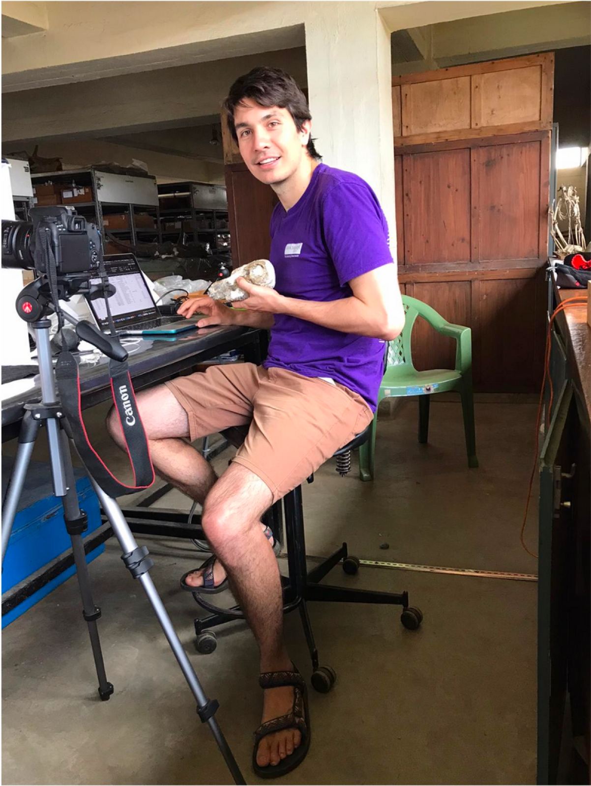

{.pub-figure .lightbox}

Whilst the field season may be over, work on the Gorongosa fossil collection continues. I have been working on photogrammetry for many of the Gorongosa fossils and building 3D models of them. I recently spent several weeks at the Nairobi National Museum in Kenya studying comparative collections and scanning material for comparison.
