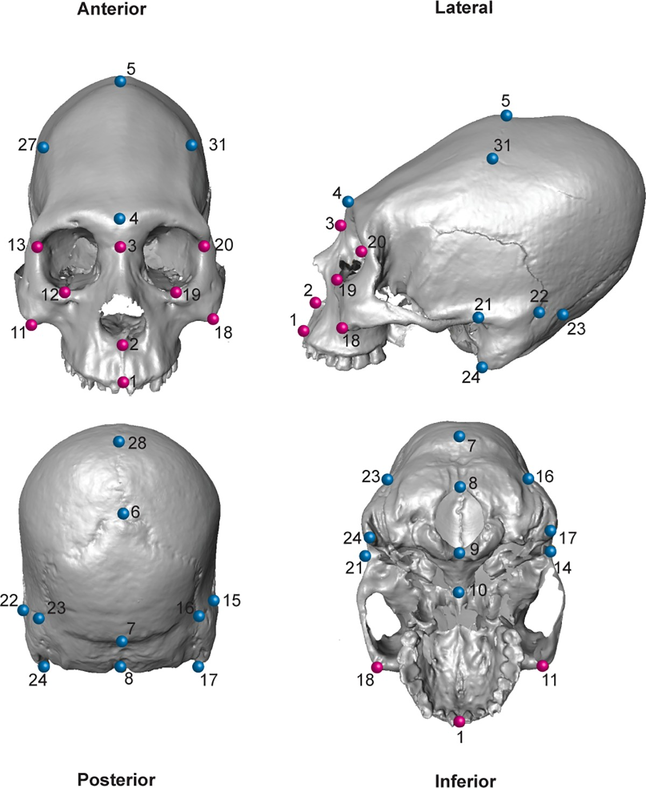

[PDF](/files/pdf/Puschel_ACD.pdf){.btn .btn-sm .btn-outline-primary .me-1 .mb-1} [Online version](https://doi.org/10.1371/journal.pone.0227362){.btn .btn-sm .btn-outline-primary .me-1 .mb-1}

```{=html}
<div class="pub-altmetric"><div data-badge-popover="right" data-badge-type="donut" data-doi="10.1371/journal.pone.0227362" data-hide-no-mentions="true" class="altmetric-embed"></div></div>
```

{.pub-figure .lightbox}

## Abstract

The cranium is an anatomically complex structure. One source of its complexity is due to its modular organization. Cranial modules are distinct and partially independent units that interact substantially during ontogeny thus generating morphological integration. Artificial Cranial Deformation (ACD) occurs when the human skull is intentionally deformed, through the use of different deforming devices applied to the head while it is developing. Hence, ACD provides an interesting example to assess the degree to which biomechanical perturbations of the developing neurocranium impact on the degree of morphological integration in the skull as a whole. The main objective of this study was to assess how ACD affects the morphological integration of the skull. This was accomplished by comparing a sample of non-deformed crania and two sets of deformed crania (i.e. antero-posterior and oblique). Both developmental and static modularity and integration were assessed through Generalized Procrustes Analysis by considering the symmetric and asymmetric components of variation in adults, using 3D landmark coordinates as raw data. The presence of two developmental modules (i.e. viscero and neurocranium) in the skull was tested. Then, in order to understand how ACD affects morphological integration, the covariation pattern between the neuro and viscerocranium was examined in antero-posterior, oblique and non-deformed cranial categories using Partial Least-Squares. The main objective of this study was to assess how ACD affects the morphological integration of the skull. This was accomplished by comparing a sample of deformed (i.e. antero-posterior and oblique) and non-deformed crania. Hence, differences in integration patterns were compared between groups. The obtained results support the modular organization of the human skull in the two analyzed modules. The integration analyses show that the oblique ACD style differentially affects the static morphological integration of the skull by increasing the covariance between neuro and viscerocranium in a more constrained way than in antero-posterior and non-deformed skulls. In addition, the antero-posterior ACD style seems to affect the developmental integration of the skull by directing the covariation pattern in a more defined manner as compared to the other cranial categories.

::: {.callout-note collapse="true" appearance="simple" icon=false}
## Cite (BibTeX)

```bibtex
@article{puschel_morphological_2020,
	title = {Morphological consequences of artificial cranial deformation: {Modularity} and integration},
	volume = {15},
	issn = {1932-6203},
	shorttitle = {Morphological consequences of artificial cranial deformation},
	url = {https://journals.plos.org/plosone/article?id=10.1371/journal.pone.0227362},
	doi = {10.1371/journal.pone.0227362},
	language = {en},
	number = {1},
	journal = {PLOS ONE},
	author = {Püschel, Thomas A. and Friess, Martin and Manríquez, Germán},
	year = {2020},
	keywords = {Covariance, Cranium, Deformation, Face, Functional morphology, Morphometry, Principal component analysis, Skull},
	pages = {e0227362}
}
```
:::
