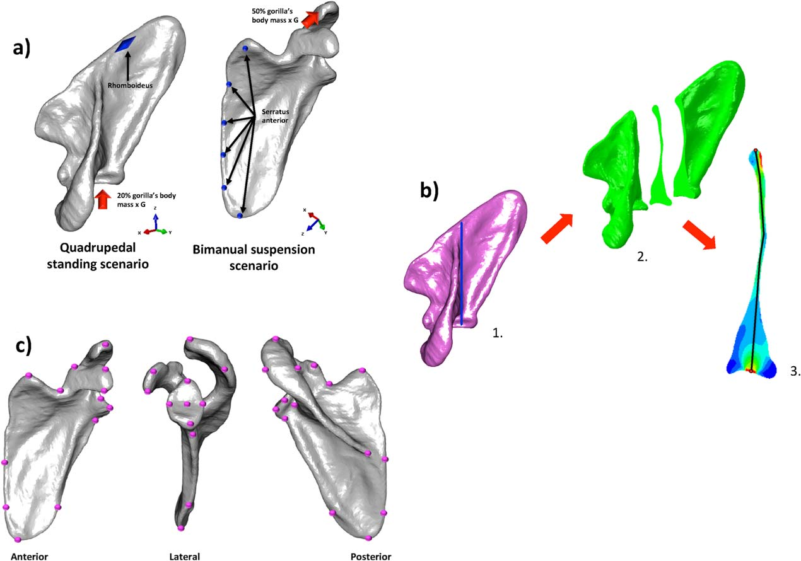

[PDF](/files/pdf/ajpa22882.pdf){.btn .btn-sm .btn-outline-primary .me-1 .mb-1} [Online version](https://doi.org/10.1002/ajpa.22882){.btn .btn-sm .btn-outline-primary .me-1 .mb-1}

```{=html}
<div class="pub-altmetric"><div data-badge-popover="right" data-badge-type="donut" data-doi="10.1002/ajpa.22882" data-hide-no-mentions="true" class="altmetric-embed"></div></div>
```

{.pub-figure .lightbox}

## Abstract

Objective The aim was to analyze the relationship between scapular form and function in hominoids by using geometric morphometrics (GM) and finite element analysis (FEA). Methods FEA was used to analyze the biomechanical performance of different hominoid scapulae by simulating static postural scenarios. GM was used to quantify scapular shape differences and the relationship between form and function was analyzed by applying both multivariate-multiple regressions and phylogenetic generalized leastsquares regressions (PGLS). Results Although it has been suggested that primate scapular morphology is mainly a product of function rather than phylogeny, our results showed that shape has a significant phylogenetic signal. There was a significant relationship between scapular shape and its biomechanical performance; hence at least part of the scapular shape variation is due to non-phylogenetic factors, probably related to functional demands. Discussion This study has shown that a combined approach using GM and FEAwas able to cast some light regarding the functional and phylogenetic contributions in hominoid scapular morphology, thus contributing to a better insight of the association between scapular form and function.

::: {.callout-note collapse="true" appearance="simple" icon=false}
## Cite (BibTeX)

```bibtex
@article{puschel_standing_2016,
	title = {Standing on the shoulders of apes: {Analyzing} the form and function of the hominoid scapula using geometric morphometrics and finite element analysis},
	volume = {159},
	issn = {1096-8644},
	shorttitle = {Standing on the shoulders of apes},
	url = {http://onlinelibrary.wiley.com/doi/10.1002/ajpa.22882/abstract},
	doi = {10.1002/ajpa.22882},

The aim was to analyze the relationship between scapular form and function in hominoids by using geometric morphometrics (GM) and finite element analysis (FEA).


Methods

FEA was used to analyze the biomechanical performance of different hominoid scapulae by simulating static postural scenarios. GM was used to quantify scapular shape differences and the relationship between form and function was analyzed by applying both multivariate-multiple regressions and phylogenetic generalized least-squares regressions (PGLS).


Results

Although it has been suggested that primate scapular morphology is mainly a product of function rather than phylogeny, our results showed that shape has a significant phylogenetic signal. There was a significant relationship between scapular shape and its biomechanical performance; hence at least part of the scapular shape variation is due to non-phylogenetic factors, probably related to functional demands.


Discussion

This study has shown that a combined approach using GM and FEA was able to cast some light regarding the functional and phylogenetic contributions in hominoid scapular morphology, thus contributing to a better insight of the association between scapular form and function. Am J Phys Anthropol 159:325–341, 2016. © 2015 Wiley Periodicals, Inc.},
	language = {en},
	number = {2},
	journal = {American Journal of Physical Anthropology},
	author = {Püschel, Thomas A. and Sellers, William I.},
	month = feb,
	year = {2016},
	keywords = {biomechanical performance, hominoidea, scapulae, shape},
	pages = {325--341}
}
```
:::
