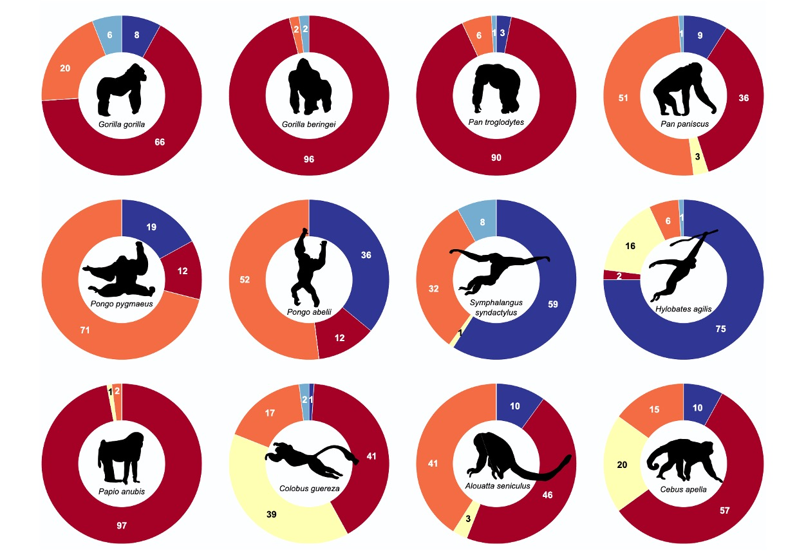

[PDF](/files/pdf/Can_mata.pdf){.btn .btn-sm .btn-outline-primary .me-1 .mb-1} [Online version](https://doi.org/10.1002/ajpa.70043){.btn .btn-sm .btn-outline-primary .me-1 .mb-1}

```{=html}
<div class="pub-altmetric"><div data-badge-popover="right" data-badge-type="donut" data-doi="10.1002/ajpa.70043" data-hide-no-mentions="true" class="altmetric-embed"></div></div>
```

{.pub-figure .lightbox}

## Abstract

The functional interpretation of postcranial remains of Middle Miocene great apes from Europe (dryopithecines) suggests a combination of quadrupedalism and orthograde behaviors without modern analogs. We provide further insights based on an isolated dryopithecine talus (IPS85037) from the Middle Miocene (11.7 Ma) Abocador de Can Mata locality ACM/C8-B* (Valles-Penedes Basin, NE Iberian Peninsula), which represents the most complete one known to date.

::: {.callout-note collapse="true" appearance="simple" icon=false}
## Cite (BibTeX)

```bibtex
@article{monclus-gonzalo_dryopithecine_2025,
	title = {A Dryopithecine Talus From Abocador de Can Mata (Vallès-Penedès Basin, {NE} Iberian Peninsula): Morphometric Affinities and Evolutionary Implications for Hominoid Locomotion},
	volume = {186},
	issn = {2692-7691},
	url = {https://onlinelibrary.wiley.com/doi/abs/10.1002/ajpa.70043},
	doi = {10.1002/ajpa.70043},
	shorttitle = {A Dryopithecine Talus From Abocador de Can Mata (Vallès-Penedès Basin, {NE} Iberian Peninsula)},
	pages = {e70043},
	number = {4},
	journaltitle = {American Journal of Biological Anthropology},
	author = {Monclús-Gonzalo, Oriol and Pal, Shubham and Püschel, Thomas A. and Urciuoli, Alessandro and Vinuesa, Víctor and Robles, Josep M. and Almécija, Sergio and Alba, David M.},
	date = {2025},
	langid = {english},
	note = {\_eprint: https://onlinelibrary.wiley.com/doi/pdf/10.1002/ajpa.70043},
	keywords = {functional morphology, geometric morphometrics, locomotion, Miocene apes, talus},
}
```
:::
