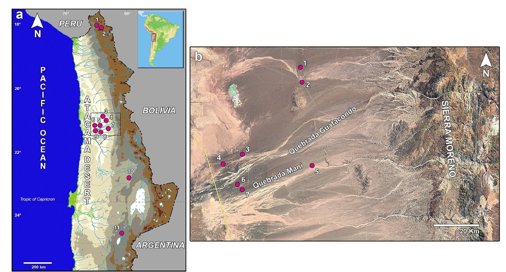

[PDF](/files/pdf/Labarca_et_al_2026.pdf){.btn .btn-sm .btn-outline-primary .me-1 .mb-1} [Online version](https://doi.org/10.1016/j.jaa.2025.101742){.btn .btn-sm .btn-outline-primary .me-1 .mb-1}

```{=html}
<div class="pub-altmetric"><div data-badge-popover="right" data-badge-type="donut" data-doi="10.1016/j.jaa.2025.101742" data-hide-no-mentions="true" class="altmetric-embed"></div></div>
```

{.pub-figure .lightbox}

## Abstract

Hunter-gatherers that spread after the Last Glacial Maximum developed a wide range of strategies to cope with environments subject to major socio-ecological transformations. The Pampa del Tamarugal (PdT), in the hyperarid core of the Atacama Desert, was tied to episodic regional positive hydroclimate anomalies (Central Andean Pluvial Events, CAPE), which enhanced bioproductivity and created a diversity of resources that transformed the basin into an ecological refuge. This environment supported hunting of small and medium-sized fauna, plant gathering, and procurement of lithic raw materials. Two distinct settlement systems were developed along Quebrada Maní wetlands and Pampa Ramaditas floodplains in the PdT basin. Quebrada Maní (ca. 12.8–11.2 ka) functioned as a seasonal residential camp associated with wetland and woodland environments, where people exploited a wide range of fauna including rodents, birds, and guanacos. In contrast, the slightly younger Pampa Ramaditas (ca. 12.4–11.3 ka) represents short-term, non-residential camps focused on small game exploitation. These findings highlight the PdT basin as a key ecological and social node in early human settlement and dispersal in South America.

::: {.callout-note collapse="true" appearance="simple" icon=false}
## Cite (BibTeX)

```bibtex
@article{labarca_diversified_2026,
	title = {Diversified human dietary strategies and settlement patterns in the core of the Atacama Desert during the late Pleistocene-Holocene transition (∼12.8 – 11.2 ka)},
	volume = {81},
	issn = {0278-4165},
	url = {https://www.sciencedirect.com/science/article/pii/S027841652500087X},
	doi = {10.1016/j.jaa.2025.101742},
	pages = {101742},
	journaltitle = {Journal of Anthropological Archaeology},
	shortjournal = {Journal of Anthropological Archaeology},
	author = {Labarca, Rafael and Ugalde, Paula C. and Capriles, José M. and Gayo, Eugenia M. and Püschel, Thomas A. and Caro, Francisco and Jarpa, Gabriela and Villavicencio, Natalia and Latorre, Claudio and Santoro, Calogero M.},
	date = {2026-03-01},
	keywords = {Atacama Desert, Dietary Strategies, middle and small-sized taxa, Late Pleistocene-Holocene transition, Logistic and residential settlement patterns},
}
```
:::
