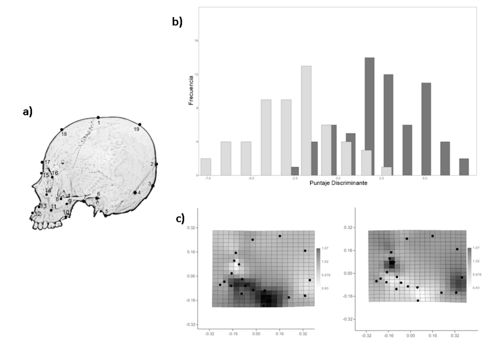

[PDF](/files/pdf/art41.pdf){.btn .btn-sm .btn-outline-primary .me-1 .mb-1} [Online version](http://dx.doi.org/10.4067/S0717-95022014000300041){.btn .btn-sm .btn-outline-primary .me-1 .mb-1}

```{=html}
<div class="pub-altmetric"><div data-badge-popover="right" data-badge-type="donut" data-doi="10.4067/S0717-95022014000300041" data-hide-no-mentions="true" class="altmetric-embed"></div></div>
```

{.pub-figure .lightbox}

## Abstract

The comparison of anatomical traits between organisms has been a central topic in comparative biology. Historically, taxanomic classification and biological diversity understanding have been based on morphological descriptions. Derived from a mathematical quantitative revolution, morphological studies have experienced an important renewal due to the development of shape analysis rooted in statistical multivariate methods and novel visualisation techniques. The aim of the present review is to provide an updated perspective regarding the progress in geometric morphometrics (GMM) applied to evolutionary biology, as well as introducing to cutting-edge subjects (e.g. developmental stability, modularity, morphological integration, among other themes). Thus, it is expected to provide a broad point of view with respect to the appliaction of geometric morphometrics in evolutionary biology, highlighting its usefulness as an effective, accurate, user-friendly and inexpensive method to quantify and study shape variation.

::: {.callout-note collapse="true" appearance="simple" icon=false}
## Cite (BibTeX)

```bibtex
@article{benitez_modelando_2014,
	title = {Modelando la {Varianza} de la {Forma}: {Morfometría} {Geométrica} {Aplicaciones} en {Biología} {Evolutiva}},
	volume = {32},
	issn = {0717-9502},
	shorttitle = {Modelando la {Varianza} de la {Forma}},
	url = {http://www.scielo.cl/scielo.php?script=sci_abstract&pid=S0717-95022014000300041&lng=es&nrm=iso&tlng=es},
	doi = {10.4067/S0717-95022014000300041},
	number = {3},
	journal = {International Journal of Morphology},
	author = {Benítez, Hugo A. and Püschel, Thomas A.},
	month = sep,
	year = {2014},
	pages = {998--1008}
}
```
:::
