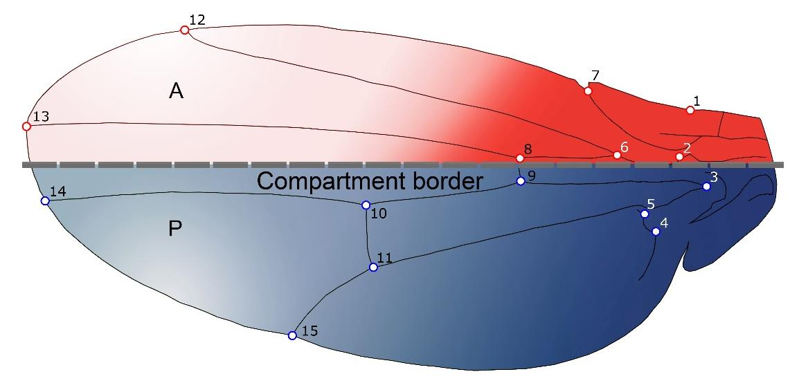

[PDF](/files/pdf/benitez_2022.pdf){.btn .btn-sm .btn-outline-primary .me-1 .mb-1} [Online version](https://doi.org/10.3390/biology11040567){.btn .btn-sm .btn-outline-primary .me-1 .mb-1}

```{=html}
<div class="pub-altmetric"><div data-badge-popover="right" data-badge-type="donut" data-doi="10.3390/biology11040567" data-hide-no-mentions="true" class="altmetric-embed"></div></div>
```

{.pub-figure .lightbox}

## Abstract

Static, developmental, and evolutionary variation are different sources of morphological variation which can be quantified using morphometrics tools. In the present study we have carried out a comparative multiple level study of integration (i.e., static, developmental, and evolutionary) to acquire insight about the relationships that exist between different integration levels, as well as to better understand their involvement in the evolutionary processes related to the diversification of *Drosophila*’s wing shape. This approach was applied to analyse wing evolution in 59 species across the whole genus in a large dataset (~10,000 wings were studied). Static integration was analysed using principal component analysis, thus providing an integration measurement for overall wing shape. Developmental integration was studied between wing parts by using a partial least squares method between the anterior and posterior compartments of the wing. Evolutionary integration was analysed using independent contrasts. The present results show that all *Drosophila* species exhibit strong morphological integration at different levels. The strong integration and overall similarities observed at multiple integration levels suggest a shared mechanism underlying this variation, which could result as consequence of genetic drift acting on the wing shape of *Drosophila*.

::: {.callout-note collapse="true" appearance="simple" icon=false}
## Cite (BibTeX)

```bibtex
@article{benitez_drosophila_2022,
	title = {Drosophila Wing Integration and Modularity: A Multi-Level Approach to Understand the History of Morphological Structures},
	volume = {11},
	rights = {http://creativecommons.org/licenses/by/3.0/},
	issn = {2079-7737},
	url = {https://www.mdpi.com/2079-7737/11/4/567},
	doi = {10.3390/biology11040567},
	shorttitle = {Drosophila Wing Integration and Modularity},
	pages = {567},
	number = {4},
	journaltitle = {Biology},
	author = {Benítez, Hugo A. and Püschel, Thomas A. and Suazo, Manuel J.},
	date = {2022-04},
	langid = {english},
	note = {Number: 4
Publisher: Multidisciplinary Digital Publishing Institute},
	keywords = {\textit{Drosophila}, developmental integration, evolutionary integration, fluctuating asymmetry, geometric morphometrics, static integration},
}
```
:::
