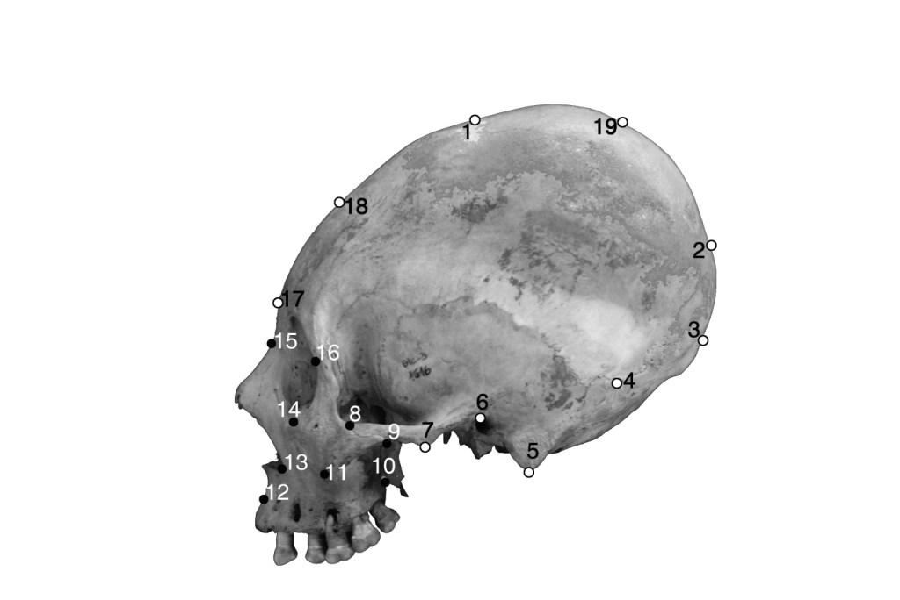

[PDF](/files/pdf/BSc.pdf){.btn .btn-sm .btn-outline-primary .me-1 .mb-1} [Online version](http://repositorio.uchile.cl/bitstream/handle/2250/116733/a%20THESIS%20PUSCHEL%20JUNIO%202013.pdf?sequence=1&isAllowed=y){.btn .btn-sm .btn-outline-primary .me-1 .mb-1}

{.pub-figure .lightbox}

## Abstract

La modificación intencional del cráneo (DIC) es el proceso de modificación corporal del patrón de crecimiento y desarrollo craneal a través de la utilización en los primeros de vida post-natal de aparatos deformadores usados con distinta intensidad. La consecuencia de dicha práctica cultural consiste en la modificación en magnitud y/o dirección de los vectores normales del crecimiento del neurocráneo. Esta es una práctica cultural ampliamente distribuida tanto geográfica como temporalmente, con alta representación en poblaciones prehistóricas sudamericanas. Las poblaciones prehistóricas de San Pedro de Atacama no son la excepción, presentando a lo largo de su secuencia cultural, a numerosos individuos con dicha modificación corporal. Se ha sugerido que los cambios en frecuencia y/o estilo deformatorio, serían producto de interacciones con grupos foráneos y/o cambios demográficos. La presente investigación tuvo por objeto el análisis cuantitativo del patrón de variación craneal en las poblaciones de SPA a lo largo de su secuencia cultural. Se deseó poner a prueba la hipótesis de que existe un patrón morfológico similar en la DIC presente en las poblaciones de SPA y los grupos de otras regiones andinas, durante los momentos de la prehistoria atacameña en los que tradicionalmente se ha propuesto contactos interregionales. Se analizaron 280 fotografías laterales de cráneos provenientes de SPA, Arica y el Altiplano mediante las técnicas de la Morfometría Geométrica en 2D. Se comparó a los individuos por período y origen geográfico respectivamente, con la finalidad de intentar establecer si las posibles similitudes morfológicas se deben o no a contactos entre distintos grupos, o por si el contrario corresponden a tradiciones locales. Por otro lado, se realizaron análisis similares con muestras de cráneos no-deformados de los mismos sitios, para así tener una contraparte no afectada por la deformación. Los resultados aquí expuestos apoyan la hipótesis que considera a la ACD de SPA como una tradición local.

::: {.callout-note collapse="true" appearance="simple" icon=false}
## Cite (BibTeX)

```bibtex
@thesis{puschel_deformacion_2012,
	location = {Santiago de Chile},
	title = {Deformación Intencional del Cráneo en los Oasis de San Pedro de Atacama: un Enfoque Morfométrico Geométrico},
	url = {http://repositorio.uchile.cl/bitstream/handle/2250/116733/a%20THESIS%20PUSCHEL%20JUNIO%202013.pdf?sequence=1&isAllowed=y},
	pagetotal = {128},
	institution = {Universidad de Chile},
	type = {{BSc} thesis},
	author = {Püschel, Thomas A.},
	date = {2012}
}
```
:::
