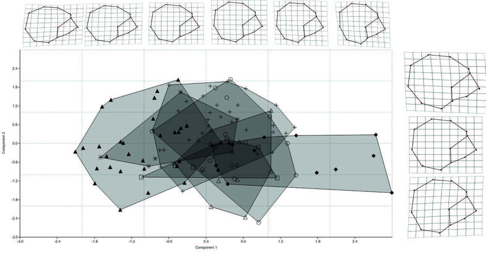

[PDF](/files/pdf/Bucchietal.pdf){.btn .btn-sm .btn-outline-primary .me-1 .mb-1} [Online version](https://revistadeantropologia.uchile.cl/index.php/RCA/article/view/45146){.btn .btn-sm .btn-outline-primary .me-1 .mb-1} [Online version](https://doi.org/10.5354/0719-1472.2017.45146){.btn .btn-sm .btn-outline-primary .me-1 .mb-1}

```{=html}
<div class="pub-altmetric"><div data-badge-popover="right" data-badge-type="donut" data-doi="10.5354/0719-1472.2017.45146" data-hide-no-mentions="true" class="altmetric-embed"></div></div>
```

{.pub-figure .lightbox}

## Abstract

Diverse hypotheses have been proposed to explain artificial cranial modification (ACM) in South America. In the Atacama area (Northern Chile), some studies have concluded that it was used to create a communal identity that could serve to resist, or to form alliances with, different external groups (Inter Site Distinction hypothesis, this work). On the other hand, other studies have suggested that there was a relationship between ACM and the social status and gender of the individuals within the community (Intra Site Distinction hypothesis, this work). These studies, however, have relied mainly on typological methods and the archaeological contexts to which these modification categories are associated have been simplified as well. In this work we use a quantitative multivariate approach to assess the relationship between cranial morphology and funerary context. The modification patterns of populations inhabiting Northern Chile during the Formative (3500-1600 B.P) and Late Intermediate (950-500 B.P.) periods were studied. We analyzed the X-rays of 203 individuals belonging to 7 archaeological sites and, when possible, they were correlated with the corresponding funerary context. The results indicate that cranial morphology correlates with the interaction networks among sites, therefore these results support the Inter Site hypothesis.

::: {.callout-note collapse="true" appearance="simple" icon=false}
## Cite (BibTeX)

```bibtex
@article{bucchi_artificial_2016,
	title = {Artificial {Cranial} {Modification} in {San} {Pedro} de {Atacama} and the {Loa} {Basin}: {A} {Quantitative} {Approach} to {Its} {Role} as a {Marker} of {Social} {Identity} ({PDF} {Download} {Available})},
	volume = {34},
	shorttitle = {Artificial {Cranial} {Modification} in {San} {Pedro} de {Atacama} and the {Loa} {Basin}},
	url = {https://www.researchgate.net/publication/314100238_Artificial_Cranial_Modification_in_San_Pedro_de_Atacama_and_the_Loa_Basin_A_Quantitative_Approach_to_Its_Role_as_a_Marker_of_Social_Identity},
	number = {2},
	journal = {Revista Chilena de Antropología},
	author = {Bucchi, Ana and Püschel, Thomas A. and Manríquez, Germán},
	year = {2016},
	pages = {19--30}
}
```
:::
