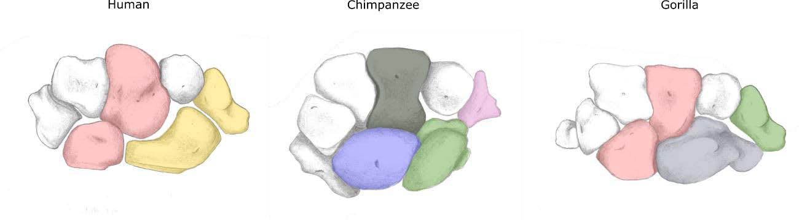

[PDF](/files/pdf/preprint_bucchi.pdf){.btn .btn-sm .btn-outline-primary .me-1 .mb-1} [Online version](https://www.preprints.org/manuscript/202004.0474/v1){.btn .btn-sm .btn-outline-primary .me-1 .mb-1} [Online version](https://doi.org/10.20944/preprints202004.0474.v1){.btn .btn-sm .btn-outline-primary .me-1 .mb-1}

```{=html}
<div class="pub-altmetric"><div data-badge-popover="right" data-badge-type="donut" data-doi="10.20944/preprints202004.0474.v1" data-hide-no-mentions="true" class="altmetric-embed"></div></div>
```

{.pub-figure .lightbox}

## Abstract

Wrist shape varies greatly across primates and previous studies indicate that the numerous morphological differences among them are related to a complex mixture of phylogeny and function. However, little is known about whether the variation in these various anatomical differences is linked and to what extent the wrist bones vary independently. Here, we used 3D geometric morphometrics on a sample of extant hominids (*Homo sapiens*, *Pan troglodytes*, *Gorilla gorilla*, and *Gorilla beringei*), to find the model that best describes the covariation patterns among four of the eight carpals (i.e., capitate, lunate, scaphoid, and trapezium). For this purpose, 15 modular hypotheses were tested using the Covariation Coefficient. Results indicate that there is a covariation structure common to all hominids, which corresponds to stronger covariation within each carpal as compared to the covariation between carpals. However, the results also indicate that that there is a degree of codependence in the variation of some carpals, which is unique in humans, chimpanzees, and gorillas, respectively. In humans there is evidence of associated shape changes between the lunate and capitate, and between the scaphoid and trapezium. This covariation between lunate and capitate is also apparent in gorillas, while chimpanzees display the greatest disassociation among carpals, showing low covariation values in all pairwise comparisons. Our analyses indicate that carpals have an important level of variational independence which might suggest a high degree of independent evolvability in the wrists of hominids, and that although weak, the structure of associated changes of these four carpals varies across genera. To our knowledge this is the first report on the patterns of modularity between these four wrist bones in the Homininae and future studies might attempt to investigate whether the anatomical shape associations among carpals are functionally related to locomotion and manipulation.

::: {.callout-note collapse="true" appearance="simple" icon=false}
## Cite (BibTeX)

```bibtex
@article{bucchi_modularity_2020,
	title = {Modularity of the Wrist in Extant Hominids},
	url = {https://www.preprints.org/manuscript/202004.0474/v1},
	doi = {10.20944/preprints202004.0474.v1},
	author = {Bucchi, Ana and Püschel, Thomas A. and Profico, Antonio and Lorenzo, Carlos},
	date = {2020-04-27},
	langid = {english},
	note = {Publisher: Preprints},
}
```
:::
