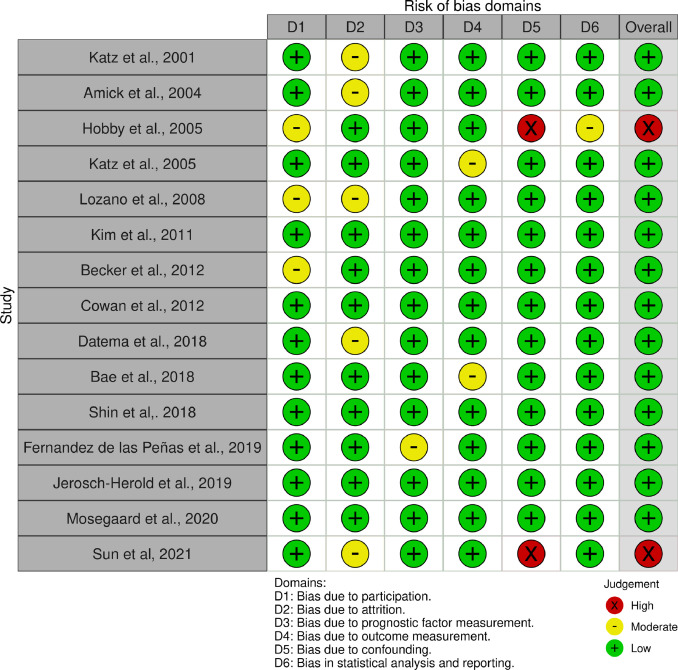

[PDF](/files/pdf/carpal_tunnel.pdf){.btn .btn-sm .btn-outline-primary .me-1 .mb-1} [Online version](https://www.sciencedirect.com/science/article/pii/S0003999321016026?dgcid=rss_sd_all#fig0002){.btn .btn-sm .btn-outline-primary .me-1 .mb-1} [Online version](https://doi.org/10.1016/j.apmr.2021.10.026){.btn .btn-sm .btn-outline-primary .me-1 .mb-1}

```{=html}
<div class="pub-altmetric"><div data-badge-popover="right" data-badge-type="donut" data-doi="10.1016/j.apmr.2021.10.026" data-hide-no-mentions="true" class="altmetric-embed"></div></div>
```

{.pub-figure .lightbox}

## Abstract

This systematic review and meta-analysis showed that symptoms of depression have a moderate association with symptom severity, function and pain after carpal tunnel release [CTR]. Symptoms of anxiety, catastrophic thinking, and self-efficacy are also important indicators of poor post-surgery outcomes. Physicians, physical therapists, and occupational therapists should consider evaluating these variables in patients undergoing CTR.

::: {.callout-note collapse="true" appearance="simple" icon=false}
## Cite (BibTeX)

```bibtex
@article{nunez-cortes_effects_2021,
	title = {Effects of cognitive and mental health factors on the outcomes following carpal tunnel release: A systematic review and meta-analysis},
	volume = {0},
	issn = {0003-9993, 1532-821X},
	url = {https://www.archives-pmr.org/article/S0003-9993(21)01602-6/fulltext},
	doi = {10.1016/j.apmr.2021.10.026},
	shorttitle = {Effects of cognitive and mental health factors on the outcomes following carpal tunnel release},
	number = {0},
	journaltitle = {Archives of Physical Medicine and Rehabilitation},
	shortjournal = {Archives of Physical Medicine and Rehabilitation},
	author = {Núñez-Cortés, Rodrigo and Cruz-Montecinos, Carlos and Torres-Castro, Rodrigo and Tapia, Claudio and Püschel, Thomas A. and Pérez-Alenda, Sofía},
	date = {2021-11-29},
	note = {Publisher: Elsevier},
	keywords = {Carpal Tunnel Syndrome, Disability, Patient Reported Outcome Measures, Postoperative pain, Psychosocial factors},
}
```
:::
