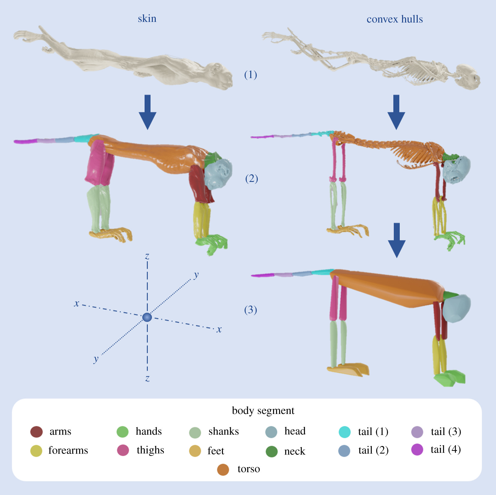

[PDF](/files/pdf/convex_hull.pdf){.btn .btn-sm .btn-outline-primary .me-1 .mb-1} [Online version](https://royalsocietypublishing.org/doi/full/10.1098/rsos.210836){.btn .btn-sm .btn-outline-primary .me-1 .mb-1} [Online version](https://doi.org/10.1098/rsos.210836){.btn .btn-sm .btn-outline-primary .me-1 .mb-1}

```{=html}
<div class="pub-altmetric"><div data-badge-popover="right" data-badge-type="donut" data-doi="10.1098/rsos.210836" data-hide-no-mentions="true" class="altmetric-embed"></div></div>
```

{.pub-figure .lightbox}

## Abstract

Obtaining accurate values for body segment parameters (BSPs) is fundamental in many biomechanical studies, particularly for gait analysis. Convex hulling, where the smallest-possible convex object that surrounds a set of points is calculated, has been suggested as an effective and time-efficient method to estimate these parameters in extinct animals, where soft tissues are rarely preserved. We investigated the effectiveness of convex hull BSP estimation in a range of extant mammals, to inform the potential future usage of this technique with extinct taxa. Computed tomography scans of both the skeleton and skin of every species investigated were virtually segmented. BSPs (the mass, position of the centre of mass and inertial tensors of each segment) were calculated from the resultant soft tissue segments, while the bone segments were used as the basis for convex hull reconstructions. We performed phylogenetic generalized least squares and ordinary least squares regressions to compare the BSPs calculated from soft tissue segments with those estimated using convex hulls, finding consistent predictive relationships for each body segment. The resultant regression equations can, therefore, be used with confidence in future volumetric reconstruction and biomechanical analyses of mammals, in both extinct and extant species where such data may not be available.

::: {.callout-note collapse="true" appearance="simple" icon=false}
## Cite (BibTeX)

```bibtex
@article{coatham_convex_2021,
	title = {Convex hull estimation of mammalian body segment parameters},
	volume = {8},
	url = {https://royalsocietypublishing.org/doi/10.1098/rsos.210836},
	doi = {10.1098/rsos.210836},
	pages = {210836},
	number = {6},
	journaltitle = {Royal Society Open Science},
	author = {Coatham, Samuel J. and Sellers, William I. and Püschel, Thomas A.},
	date = {2021},
	note = {Publisher: Royal Society},
}
```
:::
