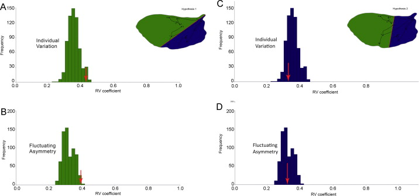

[PDF](/files/pdf/diabrotica.pdf){.btn .btn-sm .btn-outline-primary .me-1 .mb-1} [Online version](https://doi.org/10.1016/j.jcz.2014.06.001){.btn .btn-sm .btn-outline-primary .me-1 .mb-1}

```{=html}
<div class="pub-altmetric"><div data-badge-popover="right" data-badge-type="donut" data-doi="10.1016/j.jcz.2014.06.001" data-hide-no-mentions="true" class="altmetric-embed"></div></div>
```

{.pub-figure .lightbox}

## Abstract

The morphological integration of the hind wings of the western corn rootworm *Diabrotica virgifera virgifera* LeConte was investigated to get a better insight of the undergone by this invasive species. Geometric morphometric methods were used to test two modularity hypotheses associated with the wing development and function (hypothesis H1 anterior/posterior or H2 distal/proximal wing parts). Both hypotheses were rejected and the results showed the integrated behavior of the hind wings of D. v. virgifera. The hypothesized modules do not represent separate units of variation, so in a similar fashion as exhibited by the model species *Drosophila melanogaster*, the hind wings of *D. v. virgifera* act as a single functional unit. The moderate covariation strength found between anterior and posterior and distal and proximal parts of the hind wing of *D. v. virgifera* confirms its integrated behavior. We conclude that the wing shape shows internal integration, which could enable flexibility and thus enhance flight maneuverability. This study contributes to the understanding of morphological integration and modularity on a non-model organism. Additionally, these findings lay the groundwork for future flight performance and biogeographical studies on how wing shape and size vary across the endemic and expanded/invaded range in the USA and Europe infested with *D. v. virgifera*.

::: {.callout-note collapse="true" appearance="simple" icon=false}
## Cite (BibTeX)

```bibtex
@article{benitez_morphological_2014,
	title = {Morphological integration and modularity in {Diabrotica} virgifera virgifera {LeConte} ({Coleoptera}: {Chrysomelidae}) hind wings},
	volume = {253},
	issn = {0044-5231},
	shorttitle = {Morphological integration and modularity in {Diabrotica} virgifera virgifera {LeConte} ({Coleoptera}},
	url = {http://www.sciencedirect.com/science/article/pii/S0044523114000448},
	doi = {10.1016/j.jcz.2014.06.001},
	number = {6},
	journal = {Zoologischer Anzeiger - A Journal of Comparative Zoology},
	author = {Benítez, Hugo A. and Lemic, Darija and Bažok, Renata and Bravi, Raffaella and Buketa, Marina and Püschel, Thomas},
	month = aug,
	year = {2014},
	keywords = {Centroid size, Diabrotica, Wing shape, modularity, morphological integration},
	pages = {461--468}
}
```
:::
