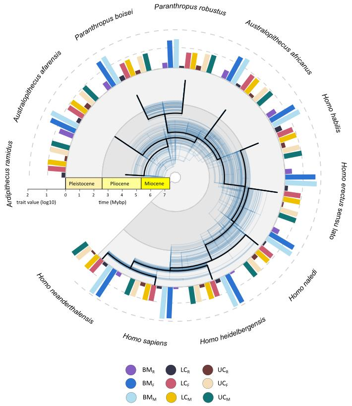

[PDF](/files/pdf/dimo_puschel_etal_2025.pdf){.btn .btn-sm .btn-outline-primary .me-1 .mb-1} [Online version](https://doi.org/10.32942/X2S05N){.btn .btn-sm .btn-outline-primary .me-1 .mb-1}

```{=html}
<div class="pub-altmetric"><div data-badge-popover="right" data-badge-type="donut" data-doi="10.32942/X2S05N" data-hide-no-mentions="true" class="altmetric-embed"></div></div>
```

{.pub-figure .lightbox}

## Abstract

Sexual dimorphism is a key indicator of social structure and selective pressures in primate evolution, yet its evolutionary drivers in hominins remain contentious. Here, we combine cutting-edge dimorphism estimation methods with Bayesian phylogenetic comparative analyses to disentangle the sex-specific contributions and evolutionary dynamics underlying changes in body mass and canine size across over 300 hominin specimens. Our results reveal a consistent reduction in body mass dimorphism over time, driven not by male body size reduction—as is predicted by prevalent hypotheses—but by a significant increase in female body mass. These findings challenge prevailing assumptions about the weakening of sexual selection on males and instead support a model of positive selection on female size, likely linked to reproductive and ecological demands. In contrast, canine size dimorphism is minimal throughout hominin evolution, with evidence of coordinated size reduction in both sexes, consistent with decreased reliance on canine-based competition. These patterns underscore divergent selective trajectories for different sexually dimorphic traits and highlight female-driven morphological evolution as a dominant force in hominin body size diversification. Our study provides a new framework for interpreting dimorphism in the fossil record and offers fresh insight into the evolutionary mechanisms shaping human ancestry.

::: {.callout-note collapse="true" appearance="simple" icon=false}
## Cite (BibTeX)

```bibtex
@article{puschel_female_2025,
	title = {Female driven reduction of sexual dimorphism in hominins},
	rights = {{CC}-By Attribution-{NonCommercial}-{NoDerivatives} 4.0 International},
	url = {https://ecoevorxiv.org/repository/view/9470/},
	author = {Püschel, Thomas A. and Avaria-Llautureo, Jorge and Venditti, Chris},
	date = {2025-06-21},
	langid = {english},
	note = {Publisher: {EcoEvoRxiv}},
}
```
:::
