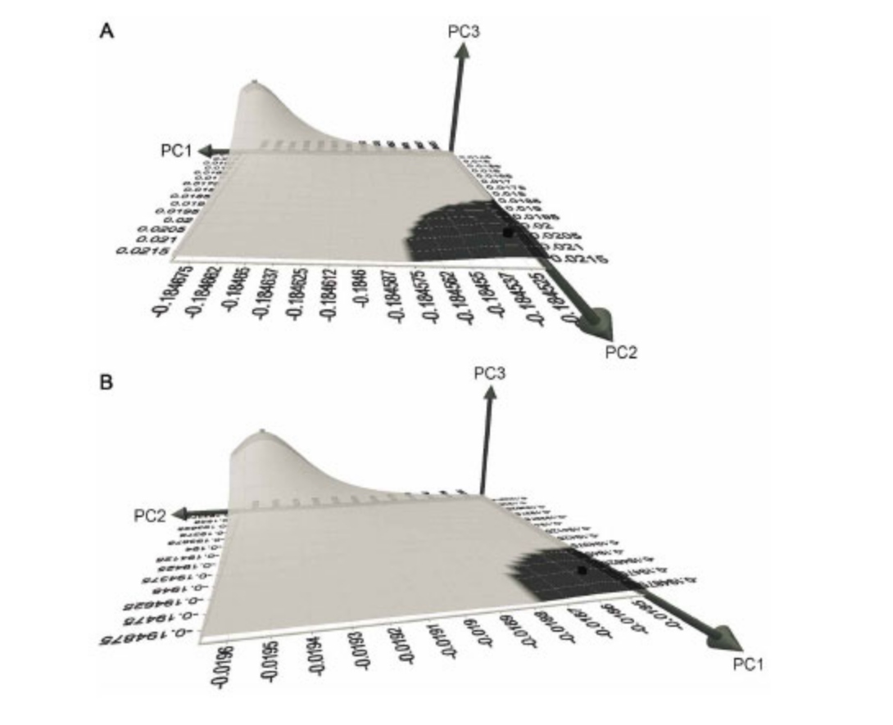

[PDF](/files/pdf/art42.pdf){.btn .btn-sm .btn-outline-primary .me-1 .mb-1} [Online version](https://scielo.conicyt.cl/scielo.php?script=sci_arttext&pid=S0717-95022014000200041&lng=en&nrm=iso&tlng=en){.btn .btn-sm .btn-outline-primary .me-1 .mb-1} [Online version](https://doi.org/10.4067/S0717-95022014000200041){.btn .btn-sm .btn-outline-primary .me-1 .mb-1}

```{=html}
<div class="pub-altmetric"><div data-badge-popover="right" data-badge-type="donut" data-doi="10.4067/S0717-95022014000200041" data-hide-no-mentions="true" class="altmetric-embed"></div></div>
```

{.pub-figure .lightbox}

## Abstract

The transition from hunting and gathering to agriculture has been associated with a gracilization in human form, especially in long bones. This has been interpreted as result of an increasingly sedentary lifestyle and reduced workload in the farming populations. However the majority of these evidences have been based on the application of different biomechanical techniques or the qualitative assessment of distinct morphological traits on attachment sites. Hence, this study tried to address whether is possible to distinguish between two different populations (hunter-gatherers and farmers) by quantifying their femoral morphology applying geometric morphometrics. We compared 16 male left femora belonging to two populations of Native Americans from the same geographic region, yet temporally and behaviorally distinct, in order to test if geometric morphometrics were able to differentiate these based solely on the quantitative analysis of shape. The femora were scanned and then small portions of them were segmented in order to generate comparable 3D models. Hundred twelve equidistant landmarks were collected over the whole femoral sections and a Procrustes analysis was performed in order to obtain shape variables. Several PCAs were carried out to elucidate morphometric associations and cross-validated DAs were applied to distinguish between hunter-gatherers and farmers. These procedures were sequentially repeated using different landmarks subsets in order to try to establish the anatomical locations where bone functional adaptation mostly occurs a) femoral cortex b) medullary cavity c) complete femoral section. The results here presented, showed that geometric morphometrics were able to distinguish between the two distinct lifestyles. Moreover, the contrasting results obtained from the analysis of the femoral cortex and the medullary cavity, suggest that long bone remodelling caused by lifestyle differences, mostly occurs on the outer surface of the femoral shaft. This study also showed a relative gracilization of the farmer as compared to the hunter-gatherers.

::: {.callout-note collapse="true" appearance="simple" icon=false}
## Cite (BibTeX)

```bibtex
@article{puschel_femoral_2014,
	title = {Femoral {Functional} {Adaptation}: {A} {Comparison} {Between} {Hunter} {Gatherers} and {Agriculturalists} {Using} {Geometric} {Morphometrics}},
	volume = {32},
	issn = {0717-9502},
	shorttitle = {Adaptación {Funcional} del {Fémur}},
	url = {http://www.scielo.cl/scielo.php?script=sci_abstract&pid=S0717-95022014000200041&lng=es&nrm=iso&tlng=en},
	doi = {10.4067/S0717-95022014000200041},
	number = {2},
	journal = {International Journal of Morphology},
	author = {Püschel, Thomas A. and Benítez, Hugo A.},
	month = jun,
	year = {2014},
	pages = {627--633}
}
```
:::
