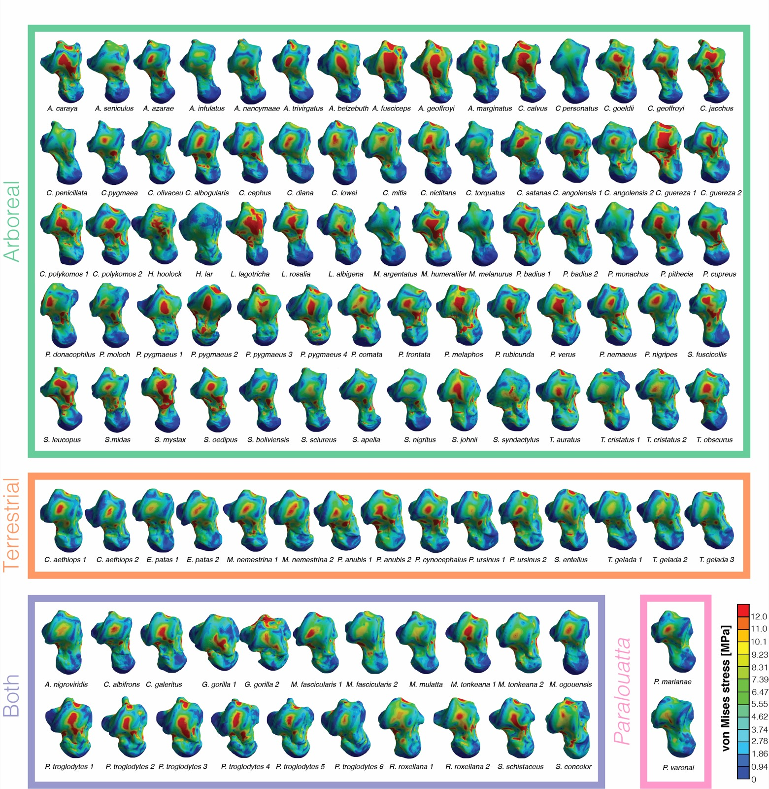

[PDF](/files/pdf/feart-08-00079-3.pdf){.btn .btn-sm .btn-outline-primary .me-1 .mb-1} [Online version](https://doi.org/10.3389/feart.2020.00079){.btn .btn-sm .btn-outline-primary .me-1 .mb-1}

```{=html}
<div class="pub-altmetric"><div data-badge-popover="right" data-badge-type="donut" data-doi="10.3389/feart.2020.00079" data-hide-no-mentions="true" class="altmetric-embed"></div></div>
```

{.pub-figure .lightbox}

## Abstract

Currently, there are no living platyrrhine primates inhabiting the main Caribbean islands. Nevertheless, the fossil record of this area has provided outstanding findings of different New World monkeys that were part of a diverse radiation exhibiting remarkably unusual morphologies. Among these, the Cuban genus *Paralouatta* corresponds to one of the most enigmatic primates ever found in the Greater Antilles. Some researchers have argued that *Paralouatta*’s post-cranium shows evidence of semi-terrestriality, a locomotor adaptation that is unusual, if not unique, in platyrrhine evolutionary history. Whether or not *Paralouatta* was truly semi-terrestrial remains uncertain, however, due to a lack of more sophisticated functional analyses on its morphology. Using novel virtual morpho-functional techniques on a comparative sample of 3D talar models belonging to diverse primate species representing three substrate preferences, this study aims to further evaluate whether *Paralouatta* was a semi-terrestrial genus or not. Geometric morphometrics and finite element analysis were used to empirically assess shape and biomechanical performance, respectively, and then several machine-learning (ML) classification algorithms were trained using both morphometric and biomechanical data to elucidate the substrate preference of the fossils. The ML algorithms categorized the *Paralouatta* specimens as either arboreal or as species commonly active on both ground and in trees. These mixed results are suggestive of some level of semi-terrestriality, thus representing the only known example of this locomotor behavior in platyrrhine evolutionary history.

::: {.callout-note collapse="true" appearance="simple" icon=false}
## Cite (BibTeX)

```bibtex
@article{puschel_getting_2020,
	title = {Getting {Its} {Feet} on the {Ground}: {Elucidating} {Paralouatta}’s {Semi}-{Terrestriality} {Using} the {Virtual} {Morpho}-{Functional} {Toolbox}},
	volume = {8},
	issn = {2296-6463},
	shorttitle = {Getting {Its} {Feet} on the {Ground}},
	url = {https://www.frontiersin.org/articles/10.3389/feart.2020.00079/full?&utm_source=Email_to_authors_&utm_medium=Email&utm_content=T1_11.5e1_author&utm_campaign=Email_publication&field=&journalName=Frontiers_in_Earth_Science&id=523089},
	doi = {10.3389/feart.2020.00079},
	language = {English},
	journal = {Frontiers in Earth Science},
	author = {Püschel, Thomas A. and Marcé-Nogué, Jordi and Gladman, Justin and Patel, Biren A. and Almécija, Sergio and Sellers, William I.},
	year = {2020},
	note = {Publisher: Frontiers},
	keywords = {Finite Element Analysis, Paralouatta, Platyrrhine, Talus, geometric morphometrics, machine-learning, semi-terrestriality}
}
```
:::
