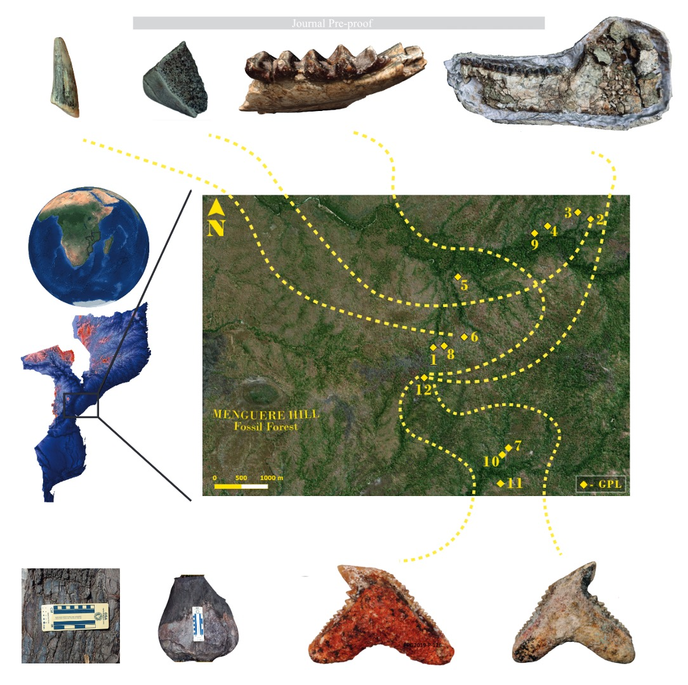

[PDF](/files/pdf/miocene_pre_proof.pdf){.btn .btn-sm .btn-outline-primary .me-1 .mb-1} [Online version](https://www.sciencedirect.com/science/article/pii/S2589004223017212){.btn .btn-sm .btn-outline-primary .me-1 .mb-1} [Online version](https://doi.org/10.1016/j.isci.2023.107644){.btn .btn-sm .btn-outline-primary .me-1 .mb-1}

```{=html}
<div class="pub-altmetric"><div data-badge-popover="right" data-badge-type="donut" data-doi="10.1016/j.isci.2023.107644" data-hide-no-mentions="true" class="altmetric-embed"></div></div>
```

{.pub-figure .lightbox}

## Abstract

The Miocene was a key time in the evolution of African ecosystems witnessing the origin of the African apes and the isolation of eastern coastal forests through an expanding arid corridor. Until recently, however, Miocene sites from the southeastern regions of the continent were unknown. Here we report the first Miocene fossil teeth from the shoulders of the Urema Rift in Gorongosa National Park, Mozambique. We provide the first 1) radiometric ages of the Mazamba Formation, 2) reconstructions of paleovegetation in the region based on pedogenic carbonates and fossil wood, and 3) descriptions of fossil teeth. Gorongosa is unique in the East African Rift in combining marine invertebrates, marine vertebrates, reptiles, terrestrial mammals, and fossil woods in coastal paleoenvironments. The Gorongosa fossil sites offer the first evidence of woodlands and forests on the coastal margins of southeastern Africa during the Miocene, and an exceptional assemblage of fossils including new species.

::: {.callout-note collapse="true" appearance="simple" icon=false}
## Cite (BibTeX)

```bibtex
@article{bobe_first_2023,
	title = {The first Miocene fossils from coastal woodlands in the southern East African Rift},
	issn = {2589-0042},
	url = {https://www.sciencedirect.com/science/article/pii/S2589004223017212},
	doi = {10.1016/j.isci.2023.107644},
	pages = {107644},
	journaltitle = {{iScience}},
	shortjournal = {{iScience}},
	author = {Bobe, René and Aldeias, Vera and Alemseged, Zeresenay and Anemone, Robert L. and Archer, Will and Aumaître, Georges and Bamford, Marion K. and Biro, Dora and Bourlès, Didier L. and Boyd, Melissa Doyle and Braun, David R. and Capelli, Cristian and Coelho, João d’Oliveira and Habermann, Jörg M. and Head, Jason J. and Keddadouche, Karim and Kupczik, Kornelius and Lebatard, Anne-Elisabeth and Lüdecke, Tina and Macôa, Amélia and Martínez, Felipe I. and Mathe, Jacinto and Mendes, Clara and Paulo, Luis Meira and Pinto, Maria and Presnyakova, Darya and Püschel, Thomas A. and Regala, Frederico Tátá and Sier, Mark and Ferreira da Silva, Maria Joana and Stalmans, Marc and Carvalho, Susana},
	date = {2023-08-15},
}
```
:::
