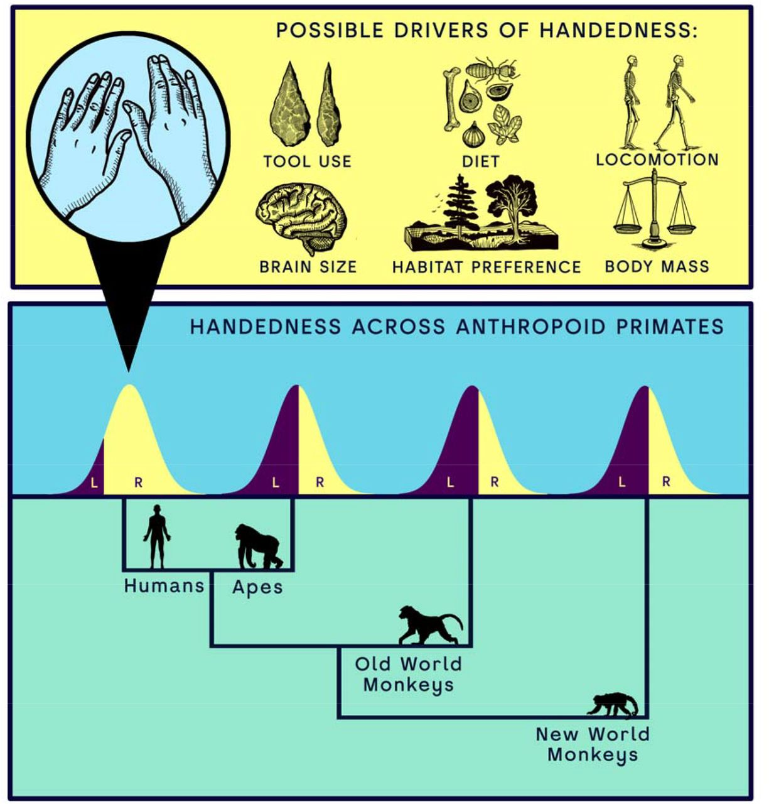

[PDF](/files/pdf/handedness.pdf){.btn .btn-sm .btn-outline-primary .me-1 .mb-1} [Online version](https://doi.org/10.1101/2025.06.17.660131){.btn .btn-sm .btn-outline-primary .me-1 .mb-1}

```{=html}
<div class="pub-altmetric"><div data-badge-popover="right" data-badge-type="donut" data-doi="10.1101/2025.06.17.660131" data-hide-no-mentions="true" class="altmetric-embed"></div></div>
```

{.pub-figure .lightbox}

## Abstract

Humans exhibit a striking and near-universal population-level right-hand preference, an evolutionary singularity unmatched among primates. Despite its pervasiveness, the origins of this lateralisation remain poorly understood. Here, we combine phylogenetic comparative methods with meta-analysis to investigate manual lateralisation across 41 anthropoid species (n = 2,025), testing longstanding eco-evolutionary hypotheses for handedness direction (MHI) and strength (MABSHI). Our models reveal significant phylogenetic signal for both traits and identify Homo sapiens as an evolutionary outlier, exhibiting exceptional rightward bias and strength relative to phylogenetic expectations. However, this outlier status disappears when brain size (endocranial volume, ECV) and intermembral index (IMI) are included, suggesting these factors are central to the emergence of human handedness. We also show that high MABSHI evolved early in hominin evolution, while MHI increased to unparalleled levels with the appearance of the genus Homo. Our findings implicate bipedalism and neuroanatomical expansion as key drivers of uniquely human lateralisation, while also revealing broader ecological patterns shaping handedness across primates. This work provides a framework for disentangling human-specific adaptations from general primate trends in the evolution of behavioural asymmetries.

::: {.callout-note collapse="true" appearance="simple" icon=false}
## Cite (BibTeX)

```bibtex
@misc{puschel_phylogenetic_2025,
	title = {Phylogenetic meta-analysis implicates large brains and our unusual posture in human handedness},
	rights = {© 2025, Posted by Cold Spring Harbor Laboratory. The copyright holder for this pre-print is the author. All rights reserved. The material may not be redistributed, re-used or adapted without the author's permission.},
	url = {https://www.biorxiv.org/content/10.1101/2025.06.17.660131v1},
	doi = {10.1101/2025.06.17.660131},
	publisher = {{bioRxiv}},
	author = {Püschel, Thomas A. and Hurwitz, Rachel M. and Venditti, Chris},
	date = {2025-06-20},
	langid = {english},
	note = {Pages: 2025.06.17.660131
Section: New Results},
}
```
:::
