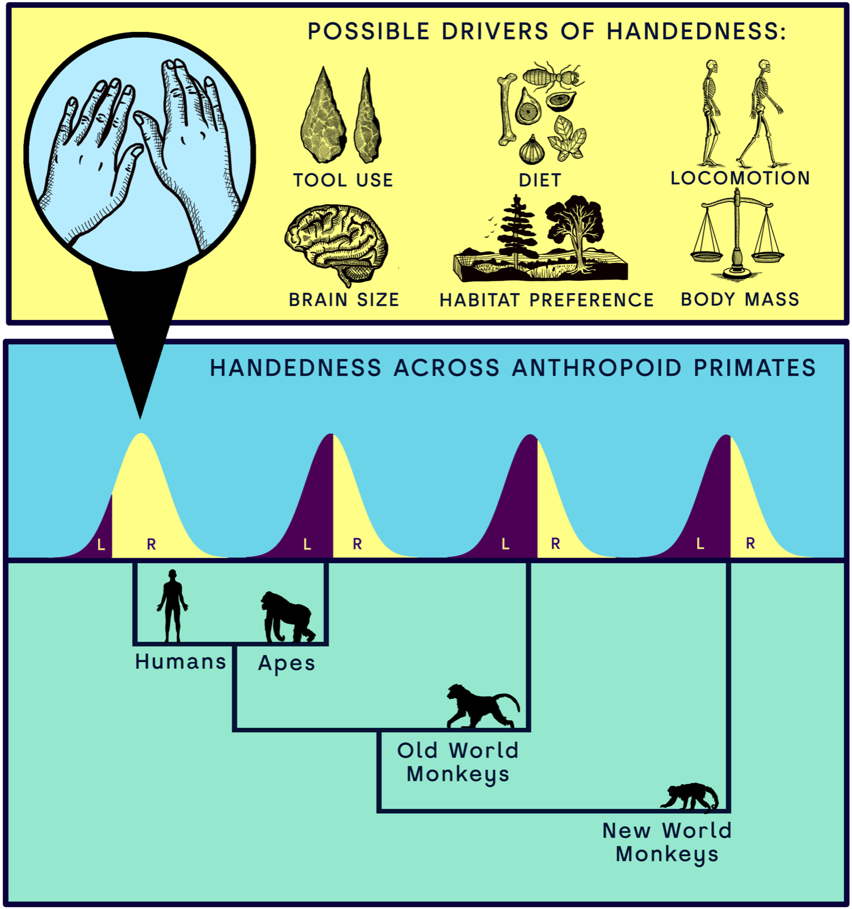

[PDF](/files/pdf/handedness_2026.pdf){.btn .btn-sm .btn-outline-primary .me-1 .mb-1} [Online version](https://doi.org/10.1371/journal.pbio.3003771){.btn .btn-sm .btn-outline-primary .me-1 .mb-1}

```{=html}
<div class="pub-altmetric"><div data-badge-popover="right" data-badge-type="donut" data-doi="10.1371/journal.pbio.3003771" data-hide-no-mentions="true" class="altmetric-embed"></div></div>
```

{.pub-figure .lightbox}

## Abstract

Humans exhibit a striking and near-universal population-level right-hand preference, an evolutionary singularity unmatched among primates. Despite its pervasiveness, the origins of this lateralization remain poorly understood. Here, we combine phylogenetic comparative methods with meta-analysis to investigate manual lateralization across 41 anthropoid species (n = 2,025), testing longstanding eco-evolutionary hypotheses for handedness direction (mean handedness index, MHI) and strength (mean absolute handedness index, MABSHI). Our models reveal significant phylogenetic signal for both traits and identify Homo sapiens as an evolutionary outlier, exhibiting exceptional rightward bias and strength relative to phylogenetic expectations. However, this outlier status disappears when brain size (endocranial volume) and intermembral index are included, suggesting these factors are central to the emergence of human handedness. We also show that high MABSHI evolved early in hominin evolution, while MHI increased to unparalleled levels with the appearance of the genus Homo. Our findings identify bipedalism and neuroanatomical expansion as likely key drivers of uniquely human lateralization, while also revealing broader ecological patterns shaping handedness across primates. This work provides a framework for disentangling human-specific adaptations from general primate trends in the evolution of behavioral asymmetries.

::: {.callout-note collapse="true" appearance="simple" icon=false}
## Cite (BibTeX)

```bibtex
@article{puschel_bipedalism_2026,
	title = {Bipedalism and brain expansion explain human handedness},
	volume = {24},
	issn = {1545-7885},
	url = {https://journals.plos.org/plosbiology/article?id=10.1371/journal.pbio.3003771},
	doi = {10.1371/journal.pbio.3003771},
	pages = {e3003771},
	number = {4},
	journaltitle = {{PLOS} Biology},
	shortjournal = {{PLOS} Biology},
	publisher = {Public Library of Science},
	author = {Püschel, Thomas A. and Hurwitz, Rachel M. and Venditti, Chris},
	date = {2026-04-27},
	langid = {english},
	keywords = {Primates, Human evolution, Phylogenetic analysis, Animal phylogenetics, Biological locomotion, Phylogenetics, Hominins, Metaanalysis},
}
```
:::
