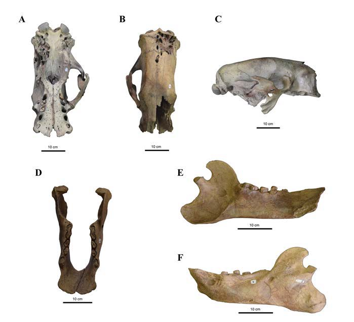

[PDF](/files/pdf/glosso.pdf){.btn .btn-sm .btn-outline-primary .me-1 .mb-1} [Online version](http://publicaciones.mnhn.gob.cl/668/w3-article-79327.html){.btn .btn-sm .btn-outline-primary .me-1 .mb-1}

{.pub-figure .lightbox}

## Abstract

The Mylodontidae family was once one of the most diverse Pleistocene fauna in South America. Within this family, the genus *Glossotherium* showed a wide distribution in the southern cone with a single record in Chile SGO.PV.2 housed at the National Museum of Natural History of Chile. Provided that the species allocation of this individual as *Glossotherium lettsomi* was made 48 years ago, a revision was carried out considering new taxonomic studies. Based on this recent information, a new diagnosis of the specimen was carried out. Principal component analyses (PCA) and a linear discriminant analyses (LDA) were performed using comparative cranial data obtained from the literature in order to establish initial morphological affinities. In addition, a phylogenetic inference analysis was conducted to establish the phylogenetic position of SGO.PV.2. Finally, the first description of the post-cranial skeleton of SGO.PV.2 is also provided. The results of the different analyzes performed in this study indicate that SGO.PV.2 should be assigned to the species *Glossotherium robustum*, thus currently representing the only record of this species in Chile.

::: {.callout-note collapse="true" appearance="simple" icon=false}
## Cite (BibTeX)

```bibtex
@article{puschel_taxonomic_2017,
	title = {Taxonomic {Comments} of a {Glossotherium} {Specimen} from the {Pleistocene} of {Central} {Chile}},
	volume = {66},
in Chile SGO.PV.2 housed at the National Museum of Natural History of Chile. Provided that the species allocation of this individual as Glossotherium lettsomi was made 48 years ago, a revision was
carried out considering new taxonomic studies. Based on this recent information, a new diagnosis of the specimen was carried out. Principal component analyses (PCA) and a linear discriminant analyses
(LDA) were performed using comparative cranial data obtained from the literature in order to establish initial morphological affinities. In addition, a phylogenetic inference analysis was conducted to establish the phylogenetic position of SGO.PV.2. Finally, the first description of the post-cranial skeleton of SGO.PV.2 is also provided. The results of the different analyzes performed in this study indicate that SGO.PV.2 should be assigned to the species Glossotherium robustum, thus currently representing the only record of this species in Chile.},
	number = {2},
	journal = {Boletín del Museo Nacional de Historia Natural, Chile},
	author = {Püschel, Hans P. and Püschel, Thomas A. and Rubilar-Rogers, David},
	year = {2017},
	pages = {223--262}
}
```
:::
