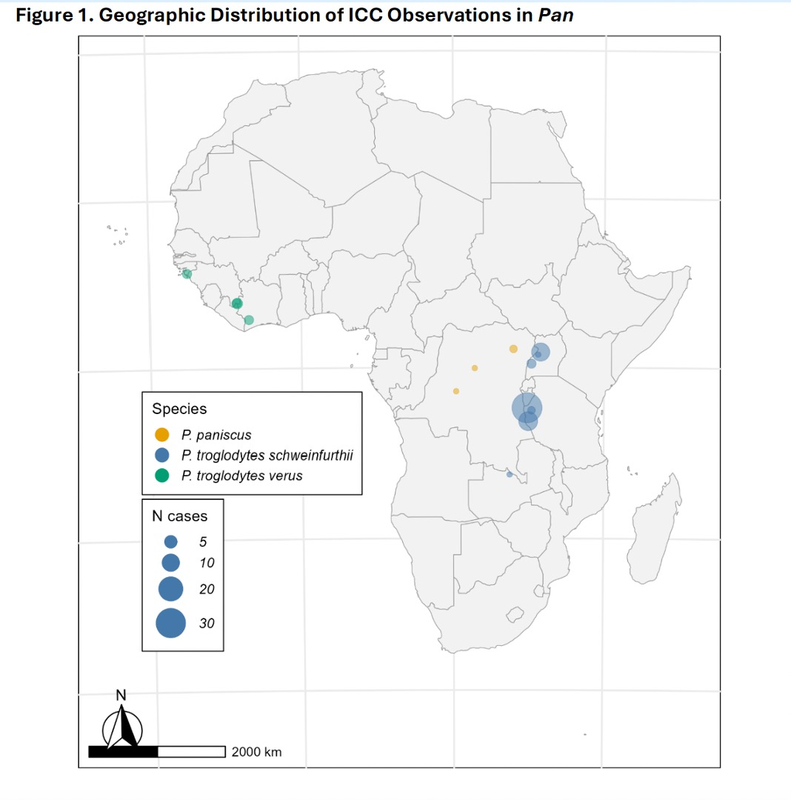

[PDF](/files/pdf/icc_pan_biorxiv.pdf){.btn .btn-sm .btn-outline-primary .me-1 .mb-1} [Online version](https://doi.org/10.64898/2026.01.28.702208){.btn .btn-sm .btn-outline-primary .me-1 .mb-1}

```{=html}
<div class="pub-altmetric"><div data-badge-popover="right" data-badge-type="donut" data-doi="10.64898/2026.01.28.702208" data-hide-no-mentions="true" class="altmetric-embed"></div></div>
```

{.pub-figure .lightbox}

## Abstract

Infant corpse carrying (ICC) is widely observed in chimpanzees and bonobos, yet its underlying mechanisms remain debated. Analysing 83 published cases using Bayesian mixed-effects models, we show that ICC duration varies with infant age at death, cause of death, and site-level interbirth intervals, with longer carrying following disease-related deaths, older infant age, and slower life histories. These results suggest that variation in ICC duration is best explained by the persistence of maternal behavioural systems modulated by carrying risk, dyadic bond strength, and life-history context, rather than by mothers recognising death as an irreversible biological state. Given the close evolutionary relationship between Pan and Homo, this implies that the cognitive frameworks required to recognise death’s finality likely emerged in the hominin lineage after divergence from the Pan–Homo last common ancestor.

::: {.callout-note collapse="true" appearance="simple" icon=false}
## Cite (BibTeX)

```bibtex
@article{hammond_infant_2026,
	title = {Infant corpse carrying in Pan reflects maternal attachment and death context},
	url = {https://www.biorxiv.org/content/10.64898/2026.01.28.702208.abstract},
	pages = {2026--01},
	journaltitle = {{bioRxiv}},
	publisher = {Cold Spring Harbor Laboratory},
	author = {Hammond, Reece and Püschel, Thomas A.},
	date = {2026},
}
```
:::
