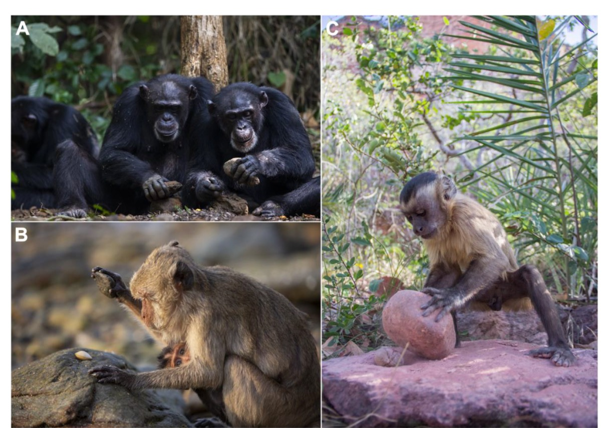

[PDF](/files/pdf/Hurwitz_et_al_preprint.pdf){.btn .btn-sm .btn-outline-primary .me-1 .mb-1} [Online version](https://doi.org/10.32942/X23X0V){.btn .btn-sm .btn-outline-primary .me-1 .mb-1}

```{=html}
<div class="pub-altmetric"><div data-badge-popover="right" data-badge-type="donut" data-doi="10.32942/X23X0V" data-hide-no-mentions="true" class="altmetric-embed"></div></div>
```

{.pub-figure .lightbox}

## Abstract

Despite recent advances pushing back the earliest record of tool use, how and when it first emerged in the hominin lineage, and the extent to which it featured amongst the numerous co-existing hominin species, remain critical questions in palaeoanthropology. In addition to analysing extinct hominin fossils and lithic toolkits, tool-use in extant primates should be studied to help answer this question. Novel strides in understanding this phenomenon may be made by studying the skeletons of our closest living relatives, the great apes, as well as more distantly related tool-using primates and applying the resultant findings to the fossil record via predictive modelling methods. Thus, we review methods of extrapolating tool use capabilities in extinct and extant taxa, and provide an innovative methodological framework to collect and analyse osteological remains for evidence of percussive tool use, using chimpanzees as a case study. We propose a shift in current methodological practice, wherein both sides of the body, rather than just one, must be routinely scanned (i.e. photogrammetry, structured light, computed tomography) to facilitate more insightful understanding of the effect of percussive tool use on primate bone. Key species, including long-tailed macaques (Macaca fascicularis ssp.), robust and gracile capuchins (Sapajus and Cebus sp.) and western chimpanzees (Pan troglodytes verus), all of whom engage in lithic percussion, should be the work’s focus. Due to bone’s dynamic ability to respond to mechanical strain by preferential remodelling, percussive forms of tool-use, like nut-cracking, are expected to cause morphological changes to bone in the preferred hammering hands of these tool users as compared to their non-preferred hand, or the hands of individuals who do not utilize lithics. However, this potential ‘damage signature’ has not been examined or quantified. Thus, we propose a methodology for examining the effect of percussive tool use on primate bone by scanning skeletal remains bilaterally, analysing directional asymmetry, and using machine learning to discern patterns of variation. Long-term, our proposed methodology may be extrapolated to examine the lasting impact of tool-use on the hand bones of extinct hominins.

::: {.callout-note collapse="true" appearance="simple" icon=false}
## Cite (BibTeX)

```bibtex
@article{hurwitz_impacted_2026,
	title = {Impacted Bones: Can extant primates help identify tool-use in early hominins?},
	rights = {{CC}-By Attribution-{NonCommercial}-{NoDerivatives} 4.0 International},
	url = {https://ecoevorxiv.org/repository/view/12137/},
	shorttitle = {Impacted Bones},
	publisher = {{EcoEvoRxiv}},
	author = {Hurwitz, Rachel and Almeida-Warren, Katarina and Carvalho, Susana and Püschel, Thomas A.},
	date = {2026-03-15},
	langid = {english},
}
```
:::
