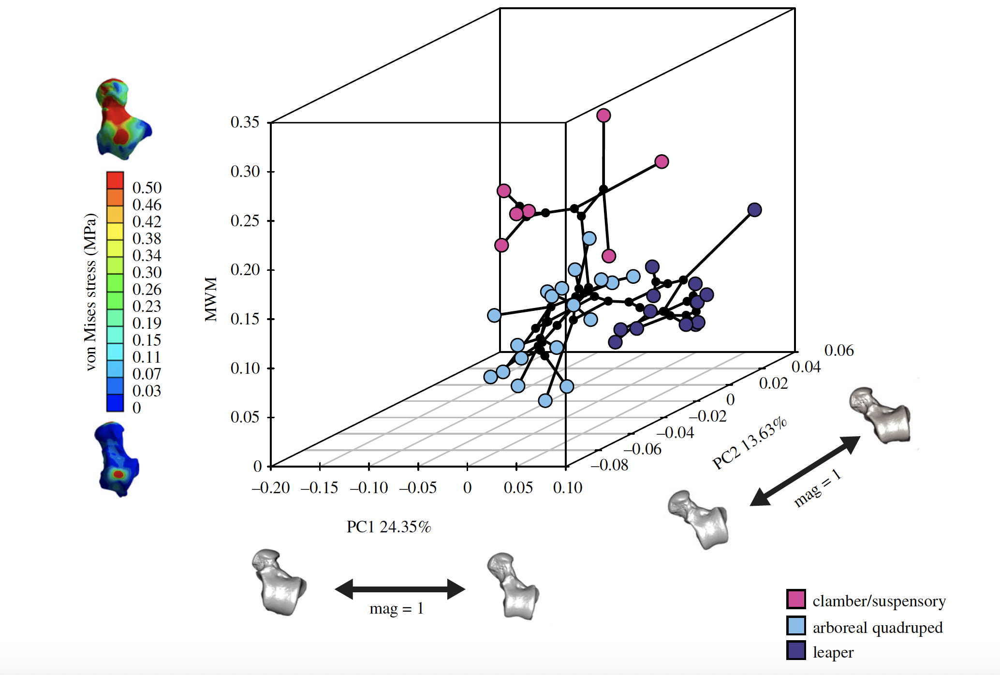

[PDF](/files/pdf/rsif.pdf){.btn .btn-sm .btn-outline-primary .me-1 .mb-1} [Online version](https://royalsocietypublishing.org/doi/full/10.1098/rsif.2018.0520){.btn .btn-sm .btn-outline-primary .me-1 .mb-1} [Online version](https://doi.org/10.1098/rsif.2018.0520){.btn .btn-sm .btn-outline-primary .me-1 .mb-1}

```{=html}
<div class="pub-altmetric"><div data-badge-popover="right" data-badge-type="donut" data-doi="10.1098/rsif.2018.0520" data-hide-no-mentions="true" class="altmetric-embed"></div></div>
```

{.pub-figure .lightbox}

## Abstract

The talus is one of the most commonly preserved post-cranial elements in the platyrrhine fossil record. Talar morphology can provide information about postural adaptations because it is the anatomical structure responsible for transmitting body mass forces from the leg to the foot. The aim of this study is to test whether the locomotor behaviour of fossil Miocene platyrrhines could be inferred from their talus morphology. The extant sample was classified into three different locomotor categories and then talar strength was compared using finite-element analysis. Geometric morphometrics were used to quantify talar shape and to assess its association with biomechanical strength. Finally, several machine-learning (ML) algorithms were trained using both the biomechanical and morphometric data from the extant taxa to infer the possible locomotor behaviour of the Miocene fossil sample. The obtained results show that the different locomotor categories are distinguishable using either biomechanical or morphometric data. The ML algorithms categorized most of the fossil sample as arboreal quadrupeds. This study has shown that a combined approach can contribute to the understanding of platyrrhine talar morphology and its relationship with locomotion. This approach is likely to be beneficial for determining the locomotor habits in other fossil taxa.

::: {.callout-note collapse="true" appearance="simple" icon=false}
## Cite (BibTeX)

```bibtex
@article{puschel_inferring_2018,
	title = {Inferring locomotor behaviours in {Miocene} {New} {World} monkeys using finite element analysis, geometric morphometrics and machine-learning classification techniques applied to talar morphology},
	volume = {15},
	copyright = {© 2018 The Authors.. Published by the Royal Society under the terms of the Creative Commons Attribution License http://creativecommons.org/licenses/by/4.0/, which permits unrestricted use, provided the original author and source are credited.},
	issn = {1742-5689, 1742-5662},
	url = {http://rsif.royalsocietypublishing.org/content/15/146/20180520},
	doi = {10.1098/rsif.2018.0520},
	language = {en},
	number = {146},
	journal = {Journal of The Royal Society Interface},
	author = {Püschel, Thomas A. and Marcé-Nogué, Jordi and Gladman, Justin T. and Bobe, René and Sellers, William I.},
	month = sep,
	year = {2018},
	pages = {20180520}
}
```
:::
