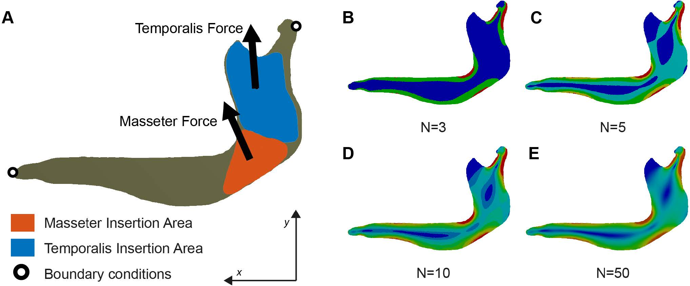

[PDF](/files/pdf/peerj-3793.pdf){.btn .btn-sm .btn-outline-primary .me-1 .mb-1} [Online version](https://peerj.com/articles/3793/){.btn .btn-sm .btn-outline-primary .me-1 .mb-1} [Online version](https://doi.org/10.7717/peerj.3793){.btn .btn-sm .btn-outline-primary .me-1 .mb-1}

```{=html}
<div class="pub-altmetric"><div data-badge-popover="right" data-badge-type="donut" data-doi="10.7717/peerj.3793" data-hide-no-mentions="true" class="altmetric-embed"></div></div>
```

{.pub-figure .lightbox}

## Abstract

Background In this paper, we propose a new method, named the intervals’ method, to analyse data from finite element models in a comparative multivariate framework. As a case study, several armadillo mandibles are analysed, showing that the proposed method is useful to distinguish and characterise biomechanical differences related to diet/ecomorphology. Methods The intervals’ method consists of generating a set of variables, each one defined by an interval of stress values. Each variable is expressed as a percentage of the area of the mandible occupied by those stress values. Afterwards these newly generated variables can be analysed using multivariate methods.Results Applying this novel method to the biological case study of whether armadillo mandibles differ according to dietary groups, we show that the intervals’ method is a powerful tool to characterize biomechanical performance and how this relates to different diets. This allows us to positively discriminate between specialist and generalist species. Discussion We show that the proposed approach is a useful methodology not affected by the characteristics of the finite element mesh. Additionally, the positive discriminating results obtained when analysing a difficult case study suggest that the proposed method could be a very useful tool for comparative studies in finite element analysis using multivariate statistical approaches.

::: {.callout-note collapse="true" appearance="simple" icon=false}
## Cite (BibTeX)

```bibtex
@article{marce-nogue_intervals_2017,
	title = {The intervals method: a new approach to analyse finite element outputs using multivariate statistics},
	volume = {5},
	issn = {2167-8359},
	shorttitle = {The intervals method},
	url = {https://peerj.com/articles/3793},
	doi = {10.7717/peerj.3793},
	language = {en},
	journal = {PeerJ},
	author = {Marcé-Nogué, Jordi and Esteban-Trivigno, Soledad De and Püschel, Thomas A. and Fortuny, Josep},
	month = oct,
	year = {2017},
	pages = {e3793}
}
```
:::
