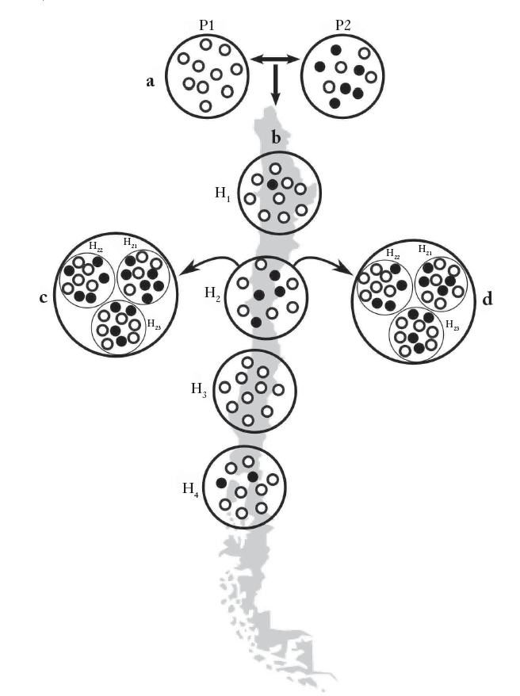

[PDF](/files/pdf/libro_chile.pdf){.btn .btn-sm .btn-outline-primary .me-1 .mb-1} [Online version](http://www.universitaria.cl/libro?isbn=9561125137){.btn .btn-sm .btn-outline-primary .me-1 .mb-1} [Online version](https://doi.org/978-956-1125-13-1){.btn .btn-sm .btn-outline-primary .me-1 .mb-1}

```{=html}
<div class="pub-altmetric"><div data-badge-popover="right" data-badge-type="donut" data-doi="978-956-1125-13-1" data-hide-no-mentions="true" class="altmetric-embed"></div></div>
```

{.pub-figure .lightbox}

## Abstract

Este capítulo revisa el estado actual del conocimiento sobre las primeras etapas del poblamiento de Chile, y la posterior evolución que han tenido las poblaciones que han habitado dicho territorio.

::: {.callout-note collapse="true" appearance="simple" icon=false}
## Cite (BibTeX)

```bibtex
@incollection{fallabela_origen_2016,
	title = {Origen y evolución de la población chilena: el punto de vista biológico},
	booktitle = {Prehistoria en {Chile}: {Desde} sus {Primeros} {Habitantes} hasta los {Incas}},
	publisher = {Editorial Universitaria},
	author = {Manríquez, Germán and Püschel, Thomas A. and Flores, Sergio and González, Tomás and Moraga, Mauricio and Rothhammer, Francisco},
	editor = {Fallabela, Fernanda and Uribe, Mauricio and Aldunate, Carlos and Hidalgo, Jorge},
	year = {2016}
}
```
:::
