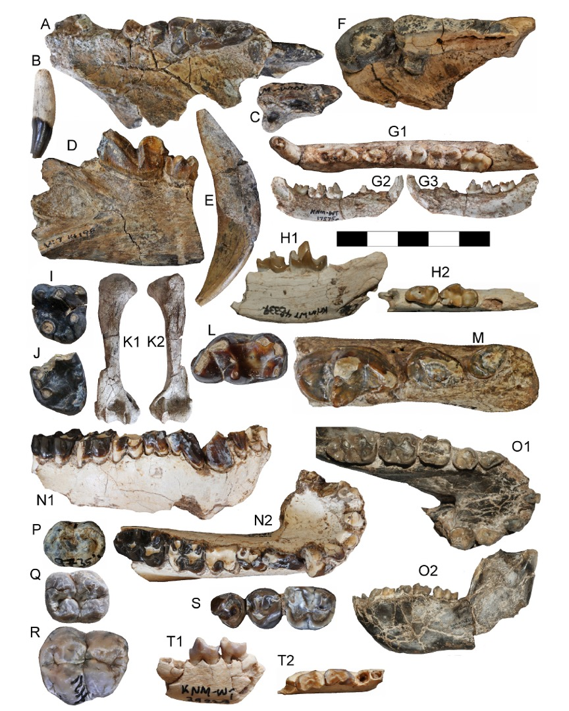

[PDF](/files/pdf/Geraads_et_al_2026.pdf){.btn .btn-sm .btn-outline-primary .me-1 .mb-1} [Online version](https://doi.org/10.1016/j.quaint.2025.110078){.btn .btn-sm .btn-outline-primary .me-1 .mb-1}

```{=html}
<div class="pub-altmetric"><div data-badge-popover="right" data-badge-type="donut" data-doi="10.1016/j.quaint.2025.110078" data-hide-no-mentions="true" class="altmetric-embed"></div></div>
```

{.pub-figure .lightbox}

## Abstract

We describe here the vertebrate fauna collected by the West Turkana Paleo Project at Lomekwi, a site best known for yielding the holotype of Kenyanthropus platyops and Lomekwian stone tools, and consisting of several collecting areas providing fossil samples ranging in age from about 3.6 to 2.2 Ma. Analysis of newly recovered material, alongside a revision of earlier collections, has led to the identification of 85 vertebrate taxa. These provide biochronological evidence refining the site's chronology and offer insights into paleoenvironmental conditions during a key phase of early hominin diversification. The fauna indicates that hominins coexisted with a diverse vertebrate community, including abundant megaherbivores, numerous artiodactyl species, a range of carnivores, and large crocodilian predators. Among primates, Theropithecus is consistently associated with hominins. Paleoenvironmental evidence highlights the dynamic and complex habitats of the Turkana region during the Pliocene.

::: {.callout-note collapse="true" appearance="simple" icon=false}
## Cite (BibTeX)

```bibtex
@article{geraads_late_2026,
	title = {The Late Pliocene to Early Pleistocene Lomekwi faunas, West Turkana, Kenya: systematics, paleoecology, and biochronology},
	volume = {754},
	issn = {1040-6182},
	url = {https://www.sciencedirect.com/science/article/pii/S1040618225004215},
	doi = {10.1016/j.quaint.2025.110078},
	shorttitle = {The Late Pliocene to Early Pleistocene Lomekwi faunas, West Turkana, Kenya},
	pages = {110078},
	journaltitle = {Quaternary International},
	shortjournal = {Quaternary International},
	author = {Geraads, Denis and Bobe, René and Püschel, Thomas A. and Ward, Carol V. and Plavcan, J. Michael and Manthi, Fredrick Kyalo},
	date = {2026-02-01},
	keywords = {Mammalia, East Africa, Hominin, Paleoenvironment},
}
```
:::
