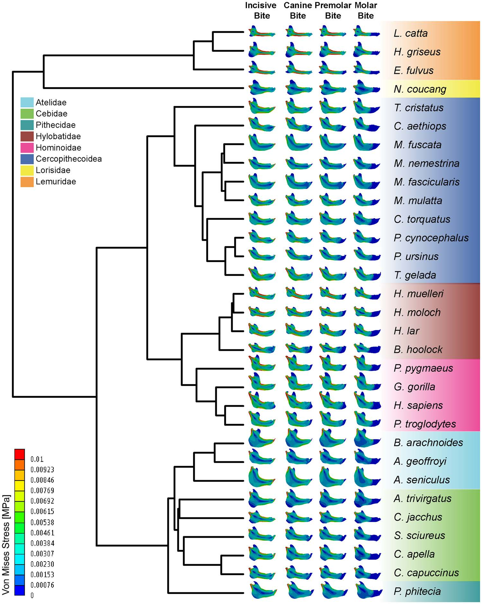

[PDF](/files/pdf/man_sci.pdf){.btn .btn-sm .btn-outline-primary .me-1 .mb-1} [Online version](https://www.nature.com/articles/s41598-017-08161-0){.btn .btn-sm .btn-outline-primary .me-1 .mb-1} [Online version](https://doi.org/10.1038/s41598-017-08161-0){.btn .btn-sm .btn-outline-primary .me-1 .mb-1}

```{=html}
<div class="pub-altmetric"><div data-badge-popover="right" data-badge-type="donut" data-doi="10.1038/s41598-017-08161-0" data-hide-no-mentions="true" class="altmetric-embed"></div></div>
```

{.pub-figure .lightbox}

## Abstract

The relationship between primate mandibular form and diet has been previously analysed by applying a wide array of techniques and approaches. Nonetheless, most of these studies compared few species and/or infrequently aimed to elucidate function based on an explicit biomechanical framework. In this study, we generated and analysed 31 Finite Element planar models of different primate jaws under different loading scenarios (incisive, canine, premolar and molar bites) to test the hypothesis that there are significant differences in mandibular biomechanical performance due to food categories and/or food hardness. The obtained stress values show that in primates, hard food eaters have stiffer mandibles when compared to those that rely on softer diets. In addition, we find that folivores species have the weakest jaws, whilst omnivores have the strongest mandibles within the order Primates. These results are highly relevant because they show that there is a strong association between mandibular biomechanical performance, mandibular form, food hardness and diet categories and that these associations can be studied using biomechanical techniques rather than focusing solely on morphology.

::: {.callout-note collapse="true" appearance="simple" icon=false}
## Cite (BibTeX)

```bibtex
@article{marce-nogue_biomechanical_2017,
	title = {A biomechanical approach to understand the ecomorphological relationship between primate mandibles and diet},
	volume = {7},
	copyright = {2017 The Author(s)},
	issn = {2045-2322},
	url = {https://www.nature.com/articles/s41598-017-08161-0},
	doi = {10.1038/s41598-017-08161-0},
	language = {En},
	number = {1},
	journal = {Scientific Reports},
	author = {Marcé-Nogué, Jordi and Püschel, Thomas A. and Kaiser, Thomas M.},
	month = aug,
	year = {2017},
	pages = {8364}
}
```
:::
