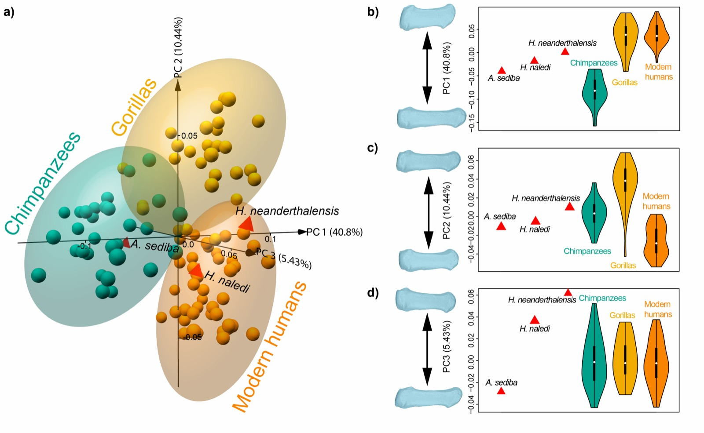

[PDF](/files/pdf/Morley_bioarxiv.pdf){.btn .btn-sm .btn-outline-primary .me-1 .mb-1} [Online version](https://doi.org/https://doi.org/10.1101/2020.04.30.070326){.btn .btn-sm .btn-outline-primary .me-1 .mb-1}

```{=html}
<div class="pub-altmetric"><div data-badge-popover="right" data-badge-type="donut" data-doi="10.1101/2020.04.30.070326" data-hide-no-mentions="true" class="altmetric-embed"></div></div>
```

{.pub-figure .lightbox}

## Abstract

Objectives Extinct hominins can provide key insights into the development of tool use, with the morphological characteristics of the thumb of particular interest due to its fundamental role in enhanced manipulation. This study quantifies the shape of the first metacarpal’s body in the extant Homininae and some fossil hominins to provide insights about the possible anatomical correlates of manipulative capabilities. Materials and methods The extant sample includes MC1s of modern humans (n=42), gorillas (n=27) and chimpanzees (n=30), whilst the fossil sample included *Homo neanderthalensis*, *Homo naledi* and *Australopithecus sediba*. 3D geometric morphometrics were used to characterize the overall shape of MC1’s body. Results Humans differ significantly from extant great apes when comparing overall shape. *H. neanderthalensis* mostly falls within the modern human range of variation although also showing a more robust morphology. *H. naledi* varies from modern human slightly, whereas *A. sediba* varies from humans to an even greater extent. When classified using a linear discriminant analysis, the three fossils are categorized within the *Homo* group.  Discussion The results are in general agreement with previous studies on the morphology of the MC1. This study found that the modern human MC1 is characterized by a distinct suite of traits, not present to the same extent in the great apes, that are consistent with an ability to use forceful precision grip. This morphology was also found to align very closely with that of *H. neanderthalensis*. *H. naledi* shows a number of human-like adaptations consistent with an ability to employ enhanced manipulation, whilst *A. sediba* apparently presents a mix of both derived and more primitive traits.

::: {.callout-note collapse="true" appearance="simple" icon=false}
## Cite (BibTeX)

```bibtex
@article{morley_characterizing_2020,
	title = {Characterizing the body morphology of the first metacarpal in the Homininae using 3D geometric morphometrics},
	rights = {© 2020, Posted by Cold Spring Harbor Laboratory. The copyright holder for this pre-print is the author. All rights reserved. The material may not be redistributed, re-used or adapted without the author's permission.},
	url = {https://www.biorxiv.org/content/10.1101/2020.04.30.070326v1},
	doi = {10.1101/2020.04.30.070326},
	pages = {2020.04.30.070326},
	journaltitle = {{bioRxiv}},
	author = {Morley, Jonathan and Bucchi, Ana and Lorenzo, Carlos and Püschel, Thomas A.},
	date = {2020-05-01},
	langid = {english},
	note = {Publisher: Cold Spring Harbor Laboratory
Section: New Results},
}
```
:::
