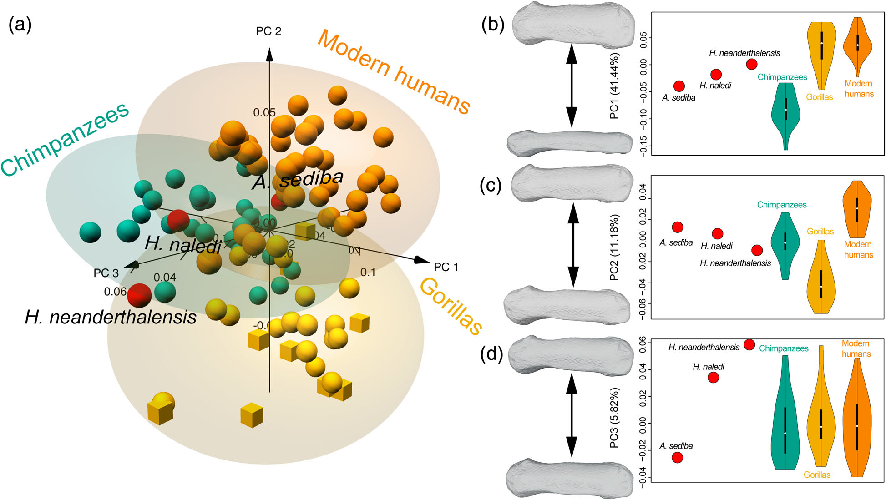

[PDF](/files/pdf/Morley_2022.pdf){.btn .btn-sm .btn-outline-primary .me-1 .mb-1} [Online version](https://onlinelibrary.wiley.com/doi/abs/10.1002/ajpa.24473){.btn .btn-sm .btn-outline-primary .me-1 .mb-1} [Online version](https://doi.org/10.1002/ajpa.24473){.btn .btn-sm .btn-outline-primary .me-1 .mb-1}

```{=html}
<div class="pub-altmetric"><div data-badge-popover="right" data-badge-type="donut" data-doi="10.1002/ajpa.24473" data-hide-no-mentions="true" class="altmetric-embed"></div></div>
```

{.pub-figure .lightbox}

## Abstract

The morphological characteristics of the thumb are of particular interest due to its fundamental role in enhanced manipulation. Despite its possible importance regarding this issue, the body of the first metacarcapal (MC1) has not been fully characterized using morphometrics. This could provide further insights into its anatomy, as well as its relationship with manipulative capabilities. Hence, this study quantifies the shape of the MC1's body in the extant Homininae and some fossil hominins to provide a better characterization of its morphology. The sample includes MC1s of modern humans (n = 42), gorillas (n = 27), and chimpanzees (n = 30), as well as *Homo neanderthalensis*, *Homo naledi*, and *Australopithecus sediba*. 3D geometric morphometrics were used to quantify the shape of MC1's body. The results show a clear distinction among the three extant genera. *H. neanderthalensis* mostly falls within the modern human range of variation. *H. naledi* varies slightly from modern humans, although also showing some unique trait combination, whereas *A. sediba* varies to an even greater extent. When classified using a discriminant analysis, the three fossils are categorized within the *Homo* group. The modern human MC1 is characterized by a distinct suite of traits, not present to the same extent in the great apes, that are consistent with an ability to use forceful precision grip. This morphology was also found to align very closely with that of *H. neanderthalensis*. *H. naledi* shows a number of human-like adaptations, while *A. sediba* presents a mix of both derived and more primitive traits.

::: {.callout-note collapse="true" appearance="simple" icon=false}
## Cite (BibTeX)

```bibtex
@article{morley_characterizing_2022,
	title = {Characterizing the body morphology of the first metacarpal in the Homininae using 3D geometric morphometrics},
	volume = {n/a},
	issn = {2692-7691},
	url = {https://onlinelibrary.wiley.com/doi/abs/10.1002/ajpa.24473},
	doi = {10.1002/ajpa.24473},
	pages = {1--12},
	issue = {n/a},
	journaltitle = {American Journal of Biological Anthropology},
	author = {Morley, Jonathan and Bucchi, Ana and Lorenzo, Carlos and Püschel, Thomas A.},
	date = {2022},
	langid = {english},
	note = {\_eprint: https://onlinelibrary.wiley.com/doi/pdf/10.1002/ajpa.24473},
	keywords = {3D geometric morphometrics, African apes, hominins, {MC}1, semi-landmarks},
}
```
:::
