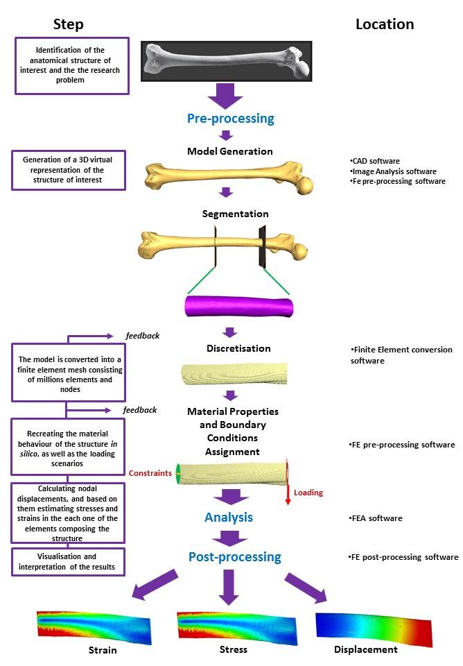

[PDF](/files/pdf/MSc.pdf){.btn .btn-sm .btn-outline-primary .me-1 .mb-1} [Online version](https://www.hyms.ac.uk/postgraduate-taught-degrees/msc-in-human-anatomy-and-evolution){.btn .btn-sm .btn-outline-primary .me-1 .mb-1}

{.pub-figure .lightbox}

## Abstract

Any behavioural reconstruction based on skeletal morphology relies on the principle that bone is functionally adapted to its mechanical environment during life. Traditional beam theory has commonly been applied in biomechanics to model the behaviour of past lifestyles of human populations. Despite its usefulness, the application of beam theory to long bones makes several unrealistic assumptions. The most noticeable one is the fact that long bones are modelled as simple beams, without taking into account their complex shapes. To this day few studies have assessed the amount of error inherent in simplification as compared with other techniques. One such alternative is the use of finite element analysis (FEA), a mechanical engineering technique that allows for more complex forms, but is much more complicated to perform. The aim of the present dissertation was to contrast the two techniques by applying both to a classical bioanthropological example, the comparison of skeletal performance between agriculturalists and hunter-gatherers. 20 male Native American left femora belonging to two distinct populations a) Norris Farm (n=10) agriculturalists and b) Black Earth (n=10) hunter-gatherers, were compared by applying both classical beam theory and FEA. The femora were scanned using a Medical CT-Scan and the data volumes were manually segmented. Cross-sectional properties were then estimated in the model and each dataset was converted into a finite element mesh to perform FEA. Statistical analyses were applied to the resultant datasets to test which technique was better differentiating between hunter-gatherers and agriculturalists. Geometric morphometrics (GMM) analyses were also carried out, in order to compare their competence when distinguishing between past lifestyles as compared with the other techniques applied. These results are expected to contribute in a better insight when assessing lifestyle from femoral shaft morphology.

::: {.callout-note collapse="true" appearance="simple" icon=false}
## Cite (BibTeX)

```bibtex
@thesis{puschel_biomechanical_2012,
	location = {York},
	title = {Biomechanical modelling of Human Femora: a comparison between Agriculturalists and Hunter-Gatherers using {FEA}, {GMM} and Beam Theory},
	url = {https://www.york.ac.uk/archaeology/postgraduate-study/taught-postgrads/masters-courses/human-anatomy-and-evolution/},
	pagetotal = {91},
	institution = {University of York, Hull York Medical School},
	type = {{MSc} thesis},
	author = {Püschel, Thomas A.},
	date = {2012}
}
```
:::
