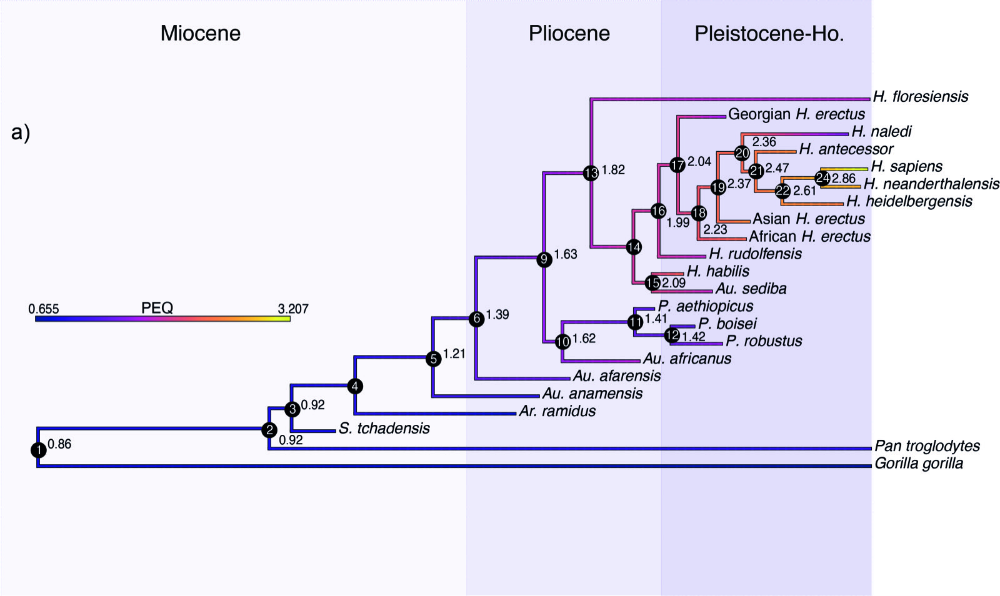

[PDF](https://rdcu.be/chUvH){.btn .btn-sm .btn-outline-primary .me-1 .mb-1} [Online version](https://doi.org/10.1038/s41559-021-01431-1){.btn .btn-sm .btn-outline-primary .me-1 .mb-1}

```{=html}
<div class="pub-altmetric"><div data-badge-popover="right" data-badge-type="donut" data-doi="10.1038/s41559-021-01431-1" data-hide-no-mentions="true" class="altmetric-embed"></div></div>
```

{.pub-figure .lightbox}

## Abstract

Quantifying speciation times during human evolution is fundamental as it provides a timescale to test for the correlation between key evolutionary transitions and extrinsic factors such as climatic or environmental change. Here, we applied a total evidence dating approach to a hominin phylogeny to estimate divergence times under different topological hypotheses. The time-scaled phylogenies were subsequently used to perform ancestral state reconstructions of body mass and phylogenetic encephalization quotient (PEQ). Our divergence-time estimates are consistent with other recent studies that analysed extant species. We show that the origin of the genus *Homo* probably occurred between 4.30 and 2.56 million years ago. The ancestral state reconstructions show a general trend towards a smaller body mass before the emergence of *Homo*, followed by a trend towards a greater body mass. PEQ estimations display a general trend of gradual but accelerating encephalization evolution. The obtained results provide a rigorous temporal framework for human evolution.

::: {.callout-note collapse="true" appearance="simple" icon=false}
## Cite (BibTeX)

```bibtex
@article{puschel_divergence-time_2021,
	title = {Divergence-time estimates for hominins provide insight into encephalization and body mass trends in human evolution},
	rights = {2021 The Author(s), under exclusive licence to Springer Nature Limited},
	issn = {2397-334X},
	url = {https://www.nature.com/articles/s41559-021-01431-1},
	doi = {10.1038/s41559-021-01431-1},
	pages = {1--12},
	journaltitle = {Nature Ecology \& Evolution},
	author = {Püschel, Hans P. and Bertrand, Ornella C. and O’Reilly, Joseph E. and Bobe, René and Püschel, Thomas A.},
	date = {2021-04-01},
	langid = {english},
	note = {Publisher: Nature Publishing Group},
}
```
:::
