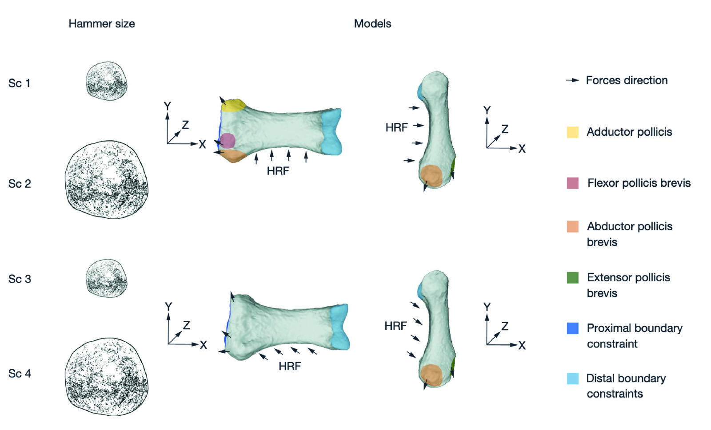

[PDF](/files/pdf/comptes-rendus-palevol-2020.pdf){.btn .btn-sm .btn-outline-primary .me-1 .mb-1} [Online version](http://sciencepress.mnhn.fr/fr/periodiques/comptes-rendus-palevol/19/2){.btn .btn-sm .btn-outline-primary .me-1 .mb-1} [Online version](https://doi.org/10.5852/cr-palevol2020v19a2){.btn .btn-sm .btn-outline-primary .me-1 .mb-1}

```{=html}
<div class="pub-altmetric"><div data-badge-popover="right" data-badge-type="donut" data-doi="10.5852/cr-palevol2020v19a2" data-hide-no-mentions="true" class="altmetric-embed"></div></div>
```

{.pub-figure .lightbox}

## Abstract

Finite element analysis was applied to analyze six individuals from different primate species (*Homo sapiens* Linnaeus, 1758, *Homo neanderthalensis* King, 1864, *Pan troglodytes* Blumenbach, 1779, *Gorilla gorilla* Savage, 1847, *Pongo pygmaeus* Linnaeus, 1760 et *Hylobates lar* Linnaeus, 1771) to identify stress distribution patterns on the pollical proximal phalanx during simulated hammerstone use. We expected the stress to be better distributed in our species than in other hominids based on the idea that, unlike apes, the human hand is adapted to tool-related behaviors. Our results indicate that the human phalanx unevenly distributes stresses and is one of the most fragile of all, especially when a small hammerstone is simulated. Tool orientation relative to the phalanx did not have a substantial effect on average stress or distribution. We conclude that great apes can resist loads exerted during this activity more efficiently than humans and that there were probably other evolutionary factors acting on this bone in our species.

::: {.callout-note collapse="true" appearance="simple" icon=false}
## Cite (BibTeX)

```bibtex
@article{bucchi_finite_2020,
	title = {Finite element analysis of the proximal phalanx of the thumb in Hominoidea during simulated stone tool use},
	volume = {19},
	url = {http://sciencepress.mnhn.fr/fr/periodiques/comptes-rendus-palevol/19/2},
	pages = {26--39},
	number = {2},
	journaltitle = {Comptes Rendus Palevol},
	author = {Bucchi, Ana and Püschel, Thomas A. and Lorenzo, Carlos and Marcé-Nogué, Jordi},
	date = {2020},
	langid = {french},
}
```
:::
