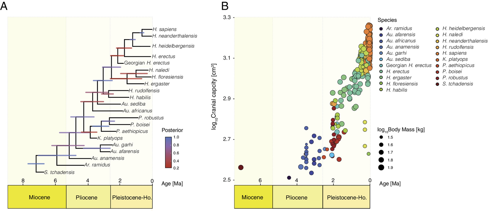

[PDF](/files/pdf/puschel-et-al-2024.pdf){.btn .btn-sm .btn-outline-primary .me-1 .mb-1} [Online version](https://doi.org/10.1073/pnas.2409542121){.btn .btn-sm .btn-outline-primary .me-1 .mb-1}

```{=html}
<div class="pub-altmetric"><div data-badge-popover="right" data-badge-type="donut" data-doi="10.1073/pnas.2409542121" data-hide-no-mentions="true" class="altmetric-embed"></div></div>
```

{.pub-figure .lightbox}

## Abstract

The fact that rapid brain size increase was clearly a key aspect of human evolution has prompted many studies focusing on this phenomenon, and many suggestions as to the underlying evolutionary patterns and processes. No study to date has however separated out the contributions of change through time within vs. between hominin species while simultaneously incorporating effects of body size. Using a phylogenetic approach never applied before to paleoanthropological data, we show that relative brain size increase across ~7 My of hominin evolution arose from increases within individual species which account for an observed overall increase in relative brain size. Variation among species in brain size after accounting for this effect is associated with body mass differences but not time. In addition, our analysis also reveals that the within-species trend escalated in more recent lineages, implying an overall pattern of accelerating relative brain size increase through time.

## Media coverage

::: {#media}
:::

::: {.callout-note collapse="true" appearance="simple" icon=false}
## Cite (BibTeX)

```bibtex
@article{puschel_hominin_2024,
	title = {Hominin brain size increase has emerged from within-species encephalization},
	volume = {121},
	url = {https://www.pnas.org/doi/10.1073/pnas.2409542121},
	doi = {10.1073/pnas.2409542121},
	pages = {e2409542121},
	number = {49},
	journaltitle = {Proceedings of the National Academy of Sciences},
	author = {Püschel, Thomas A. and Nicholson, Samuel L. and Baker, Joanna and Barton, Robert A. and Venditti, Chris},
	date = {2024-12-03},
	note = {Publisher: Proceedings of the National Academy of Sciences},
}
```
:::
