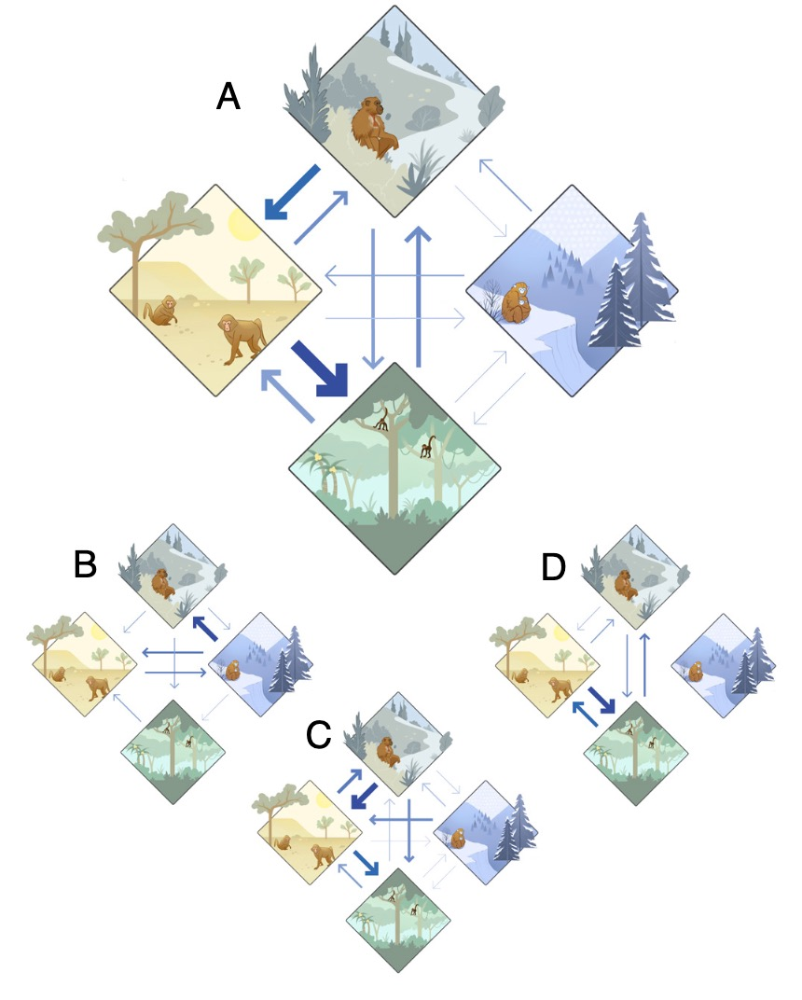

[PDF](/files/pdf/avaria_llautureo_etal_2024_v2_preprint.pdf){.btn .btn-sm .btn-outline-primary .me-1 .mb-1} [Online version](https://doi.org/10.32942/X2FS77){.btn .btn-sm .btn-outline-primary .me-1 .mb-1}

```{=html}
<div class="pub-altmetric"><div data-badge-popover="right" data-badge-type="donut" data-doi="10.32942/X2FS77" data-hide-no-mentions="true" class="altmetric-embed"></div></div>
```

{.pub-figure .lightbox}

## Abstract

One of the most influential hypotheses about primate evolution postulates that their origin, radiation, and major dispersals were associated with exceptionally warm conditions in tropical forests at northern latitudes (henceforth the warm tropical forest hypothesis). However, this notion has proven difficult to test given the overall uncertainty about both geographic locations and paleoclimates of ancestral species. By the resolution of both challenges, we reveal that early primates dispersed and radiated in higher latitudes, through diverse climates, including cold, arid, and temperate conditions. Contrary to expectations of the warm tropical forest hypothesis, warmer global temperatures had no effect on dispersal distances or the speciation rate. Rather, the amount of change in local temperature and precipitation substantially predicted geographic and species diversity. Our results suggest that nontropical, changeable environments exerted strong selective pressures on primates with higher dispersal ability – promoting the primate radiation and their subsequent colonization of tropical climates millions of years after their origin.

::: {.callout-note collapse="true" appearance="simple" icon=false}
## Cite (BibTeX)

```bibtex
@article{avaria-llautureo_radiation_2025,
	title = {The radiation and geographic expansion of primates through diverse climates},
	volume = {122},
	url = {https://www.pnas.org/doi/10.1073/pnas.2423833122},
	doi = {10.1073/pnas.2423833122},
	pages = {e2423833122},
	number = {32},
	journaltitle = {Proceedings of the National Academy of Sciences},
	author = {Avaria-Llautureo, Jorge and Püschel, Thomas A. and Meade, Andrew and Baker, Joanna and Nicholson, Samuel L. and Venditti, Chris},
	date = {2025-08-12},
	note = {Publisher: Proceedings of the National Academy of Sciences},
}
```
:::
