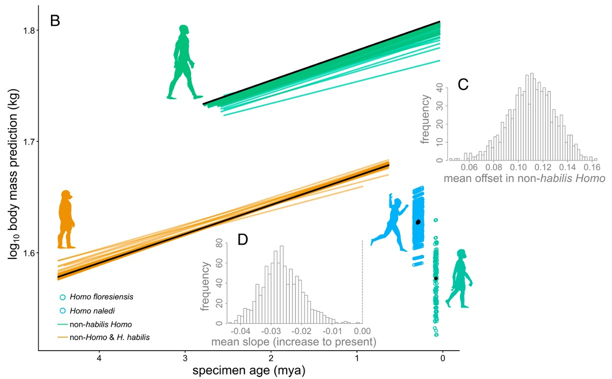

[PDF](/files/pdf/gardner-et-al-2026-pdf.pdf){.btn .btn-sm .btn-outline-primary .me-1 .mb-1} [Online version](https://doi.org/10.1073/pnas.2521732123){.btn .btn-sm .btn-outline-primary .me-1 .mb-1}

```{=html}
<div class="pub-altmetric"><div data-badge-popover="right" data-badge-type="donut" data-doi="10.1073/pnas.2521732123" data-hide-no-mentions="true" class="altmetric-embed"></div></div>
```

{.pub-figure .lightbox}

## Abstract

The evolutionary pattern of hominin body size remains debated, with previous studies supporting either gradual increases through time or shifts associated with particular lineages. Using Bayesian phylogenetic generalized linear mixed models and data from 386 specimens representing 21 taxa, this study evaluates these competing explanations while accounting for phylogenetic relationships, intraspecific variation, and multiple sources of uncertainty. The results provide strong support for a substantial increase in body mass among non-habilis and later-occurring Homo, together with moderate evidence for a broader temporal increase across hominins. The findings indicate that hominin body size evolution followed a more complex trajectory than either a simple progressive increase or a single shift across the genus Homo.

## Media coverage

::: {#media}
:::

::: {.callout-note collapse="true" appearance="simple" icon=false}
## Cite (BibTeX)

```bibtex
@article{gardner_competing_2026,
	title = {Competing models of hominin body size evolution},
	volume = {123},
	url = {https://www.pnas.org/doi/abs/10.1073/pnas.2521732123},
	doi = {10.1073/pnas.2521732123},
	pages = {e2521732123},
	number = {27},
	journaltitle = {Proceedings of the National Academy of Sciences},
	publisher = {Proceedings of the National Academy of Sciences},
	author = {Gardner, Jacob D. and Püschel, Thomas A. and White, Suzy and Sakamoto, Manabu and Venditti, Chris},
	date = {2026-07-07},
}
```
:::
