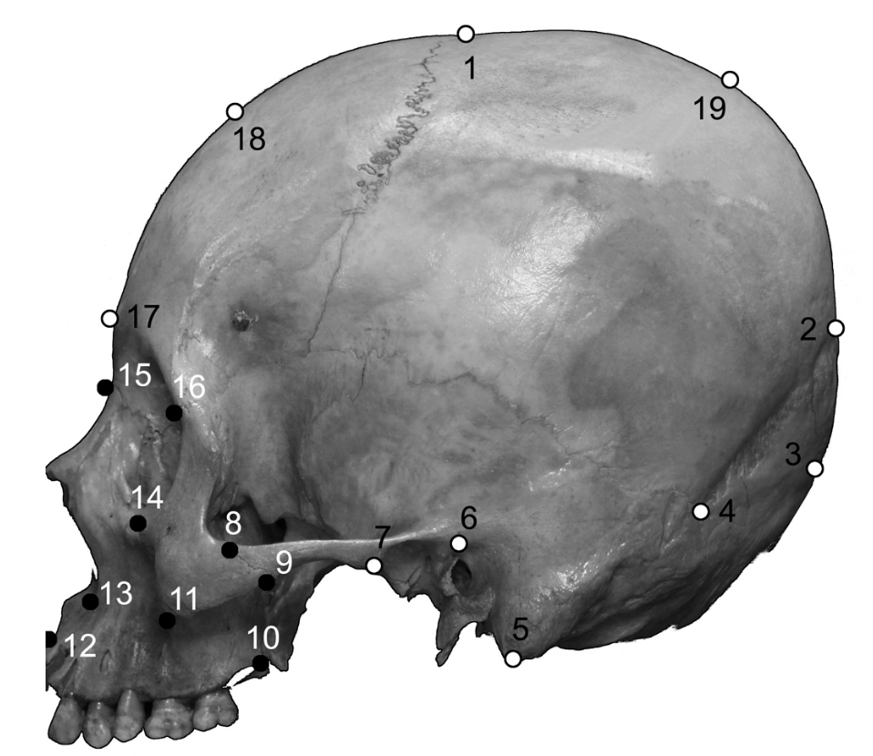

[PDF](/files/pdf/art48.pdf){.btn .btn-sm .btn-outline-primary .me-1 .mb-1} [Online version](https://scielo.conicyt.cl/scielo.php?script=sci_arttext&pid=S0717-95022014000100048){.btn .btn-sm .btn-outline-primary .me-1 .mb-1} [Online version](https://doi.org/10.4067/S0717-95022014000100048){.btn .btn-sm .btn-outline-primary .me-1 .mb-1}

```{=html}
<div class="pub-altmetric"><div data-badge-popover="right" data-badge-type="donut" data-doi="10.4067/S0717-95022014000100048" data-hide-no-mentions="true" class="altmetric-embed"></div></div>
```

{.pub-figure .lightbox}

## Abstract

Morphological Integration and modularity are concepts that refer to the covariation level between the components of a structure. Morphological modules are those structures that have components that strongly covary, which in turn are relatively independent to other modules. Morphological integration is instead, the coordinated morphological variation of a functional whole. Traditionally the skull has been divided in two modules based on their different developmental origins the splanchnocranium and the neurocranium. It has been suggested that the craniofacial development is highly integrated both functional as ontogenetically. The modularity hypothesis based on different developmental origins was tested, by using the RV coefficient. Later, the integration level was assessed applying a partial least-squares analysis (PLS). The underlying aim was to know whether the traditional division between splanchno and neurocranium has a modular basis, as well as the morphological integration level between these two structures.

::: {.callout-note collapse="true" appearance="simple" icon=false}
## Cite (BibTeX)

```bibtex
@article{puschel_modularidad_2014,
	title = {Modularidad e {Integración} {Morfológica} en {Cráneos} {Humanos}: un {Enfoque} {Morfométrico} {Geométrico}},
	volume = {32},
	issn = {0717-9502},
	shorttitle = {Modularidad e {Integración} {Morfológica} en {Cráneos} {Humanos}},
	url = {http://www.scielo.cl/scielo.php?script=sci_abstract&pid=S0717-95022014000100048&lng=es&nrm=iso&tlng=es},
	doi = {10.4067/S0717-95022014000100048},
	number = {1},
	journal = {International Journal of Morphology},
	author = {Püschel, Thomas},
	month = mar,
	year = {2014},
	pages = {299--304}
}
```
:::
