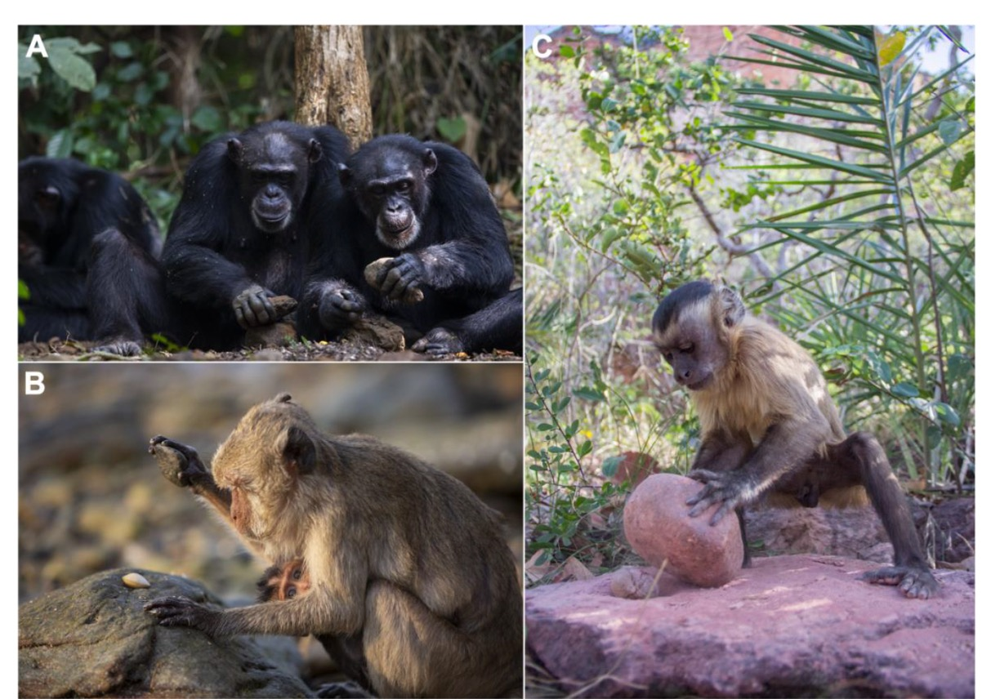

[PDF](/files/pdf/Evolutionary_Anthropology_2026.pdf){.btn .btn-sm .btn-outline-primary .me-1 .mb-1} [Online version](https://doi.org/10.1002/evan.70042){.btn .btn-sm .btn-outline-primary .me-1 .mb-1}

```{=html}
<div class="pub-altmetric"><div data-badge-popover="right" data-badge-type="donut" data-doi="10.1002/evan.70042" data-hide-no-mentions="true" class="altmetric-embed"></div></div>
```

{.pub-figure .lightbox}

## Abstract

Despite recent advances pushing back the earliest record of tool use, how and when it first emerged in hominins, and the extent to which it featured amongst the numerous co-existing species, remain critical questions in paleoanthropology. In addition to analyzing fossils and lithic toolkits, novel strides in understanding this might be made by studying the skeletons of the great apes, as well as more distantly related tool-using primates and applying resultant findings to the fossil record via predictive modelling. We review current methods of extrapolating tool-use capabilities in extinct and extant taxa and provide an innovative methodological framework to analyze osteological remains for evidence of percussive tool use, using chimpanzees as a case study. We propose a shift in current methodological practice, wherein both sides of the body, rather than just one, should be routinely scanned to understand of the effect percussive tool use on primate bone. Key species, including long-tailed macaques (Macaca fascicularis ssp.), capuchins (Sapajus and Cebus sp.) and chimpanzees (Pan troglodytes ssp.), all of whom engage in lithic percussion, should be the work's focus. Due to bone's dynamic ability to respond to mechanical strain, percussive forms of tool use, like nut-cracking, could cause morphological changes in the dominant hands of tool users as compared to their non-dominant hand, or the hands of primates who do not engage in percussive behaviors. However, this potential "damage signature" has not been quantified. Thus, we propose a methodology for examining the effect of percussive tool use on primate bone by scanning skeletal remains bilaterally, analyzing directional asymmetry, and using machine learning to discern patterns of variation. Long-term, our proposed methodology may be extrapolated to examine the lasting impact of tool use on the bones of extinct hominins.

::: {.callout-note collapse="true" appearance="simple" icon=false}
## Cite (BibTeX)

```bibtex
@article{hurwitz_impacted_2026,
	title = {Impacted Bones: Can extant primates help identify tool-use in early hominins?},
	rights = {{CC}-By Attribution-{NonCommercial}-{NoDerivatives} 4.0 International},
	url = {https://ecoevorxiv.org/repository/view/12137/},
	shorttitle = {Impacted Bones},
	publisher = {{EcoEvoRxiv}},
	author = {Hurwitz, Rachel and Almeida-Warren, Katarina and Carvalho, Susana and Püschel, Thomas A.},
	date = {2026-03-15},
	langid = {english},
}
```
:::
