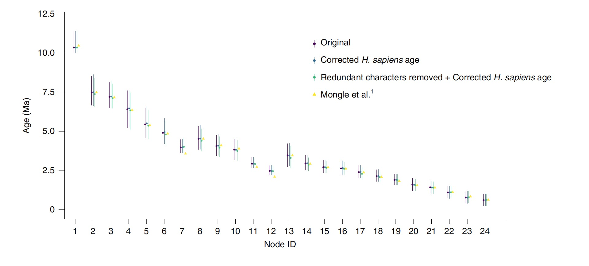

[PDF](/files/pdf/reply_nat_eco_evo.pdf){.btn .btn-sm .btn-outline-primary .me-1 .mb-1} [Online version](https://doi.org/10.1038/s41559-022-01792-1){.btn .btn-sm .btn-outline-primary .me-1 .mb-1}

```{=html}
<div class="pub-altmetric"><div data-badge-popover="right" data-badge-type="donut" data-doi="10.1038/s41559-022-01792-1" data-hide-no-mentions="true" class="altmetric-embed"></div></div>
```

{.pub-figure .lightbox}

## Abstract

In their recent communication, Mongle et al. argue that there are several problems with our recent analysis. Here we show that none of our divergence-time estimates are contrary to the current palaeoanthropological evidence and the conclusions reached by Mongle et al. are not supported, as their results are almost identical to ours. Furthermore, we also show that some of their criticisms are based on either incorrect information and flawed interpretations of the available evidence.

::: {.callout-note collapse="true" appearance="simple" icon=false}
## Cite (BibTeX)

```bibtex
@article{puschel_reply_2022,
	title = {Reply to: Modelling hominin evolution requires accurate hominin data},
	rights = {2022 The Author(s), under exclusive licence to Springer Nature Limited},
	issn = {2397-334X},
	url = {https://www.nature.com/articles/s41559-022-01792-1},
	doi = {10.1038/s41559-022-01792-1},
	shorttitle = {Reply to},
	pages = {1--3},
	journaltitle = {Nature Ecology \& Evolution},
	shortjournal = {Nat Ecol Evol},
	author = {Püschel, Hans P. and Bertrand, Ornella C. and Reilly, Joseph E. O’ and Bobe, René and Püschel, Thomas A.},
	date = {2022-07-04},
	langid = {english},
	note = {Publisher: Nature Publishing Group},
	keywords = {Biological anthropology, Phylogenetics},
}
```
:::
