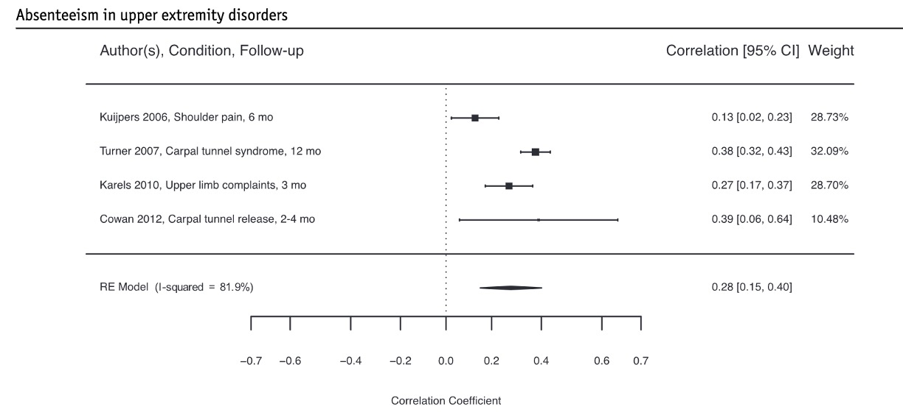

[PDF](/files/pdf/nunez-cortez_2023.pdf){.btn .btn-sm .btn-outline-primary .me-1 .mb-1} [Online version](https://www.archives-pmr.org/article/S0003-9993(23)00409-4/fulltext){.btn .btn-sm .btn-outline-primary .me-1 .mb-1} [Online version](https://doi.org/10.1016/j.apmr.2023.07.003){.btn .btn-sm .btn-outline-primary .me-1 .mb-1}

```{=html}
<div class="pub-altmetric"><div data-badge-popover="right" data-badge-type="donut" data-doi="10.1016/j.apmr.2023.07.003" data-hide-no-mentions="true" class="altmetric-embed"></div></div>
```

{.pub-figure .lightbox}

## Abstract

Rehabilitation teams should consider assessing catastrophizing and symptoms of anxiety and depression to identify patients at risk for work absenteeism. Addressing these variables may also be considered in return-to-work programs for individuals with upper limb disorders.

::: {.callout-note collapse="true" appearance="simple" icon=false}
## Cite (BibTeX)

```bibtex
@article{nunez-cortes_association_2023,
	title = {Association Between Pain Coping and Symptoms of Anxiety and Depression, and Work Absenteeism in People With Upper Limb Musculoskeletal Disorders: A Systematic Review and Meta-analysis},
	volume = {0},
	issn = {0003-9993, 1532-821X},
	url = {https://www.archives-pmr.org/article/S0003-9993(23)00409-4/fulltext},
	doi = {10.1016/j.apmr.2023.07.003},
	shorttitle = {Association Between Pain Coping and Symptoms of Anxiety and Depression, and Work Absenteeism in People With Upper Limb Musculoskeletal Disorders},
	number = {0},
	journaltitle = {Archives of Physical Medicine and Rehabilitation},
	shortjournal = {Archives of Physical Medicine and Rehabilitation},
	author = {Núñez-Cortés, Rodrigo and Espin, Ander and Pérez-Alenda, Sofía and López-Bueno, Rubén and Cruz-Montecinos, Carlos and Vincents-Seeberg, Karina Glies and Püschel, Thomas A. and Calatayud, Joaquín and Andersen, Lars Louis},
	date = {2023-07-23},
	pmid = {37490961},
	note = {Publisher: Elsevier},
	keywords = {36-item short form health survey (Mental component), Center for Epidemiologic Studies Depression Scale, {CES}-D, {CI}, confidence interval, Coping Strategy Questionnaire, {CSQ}, E-{RTW}, early return to work, {FABQ}, Fear Avoidance Beliefs Questionnaire, General Self-Efficacy Scale, {GSES}, L-{RTW}, late return to work, Pain, Pain Anxiety Symptom Scale, Pain Catastrophizing Scale, Pain Coping and Cognition List, Pain Self-Efficacy Questionnaire, {PASS}, Patient Health Questionnaire, {PCCL}, {PCS}, {PHQ}-9, {PSEQ}, Psychosocial functioning, Rehabilitation, Return to work, Return to Work, {RTW}, {SF}-36 {MC}, Sick leave, Tampa scale of kinesiophobia, {TSK}, Upper extremity, Veterans {RAND} Mental Component Score, {VRMCS}},
}
```
:::
