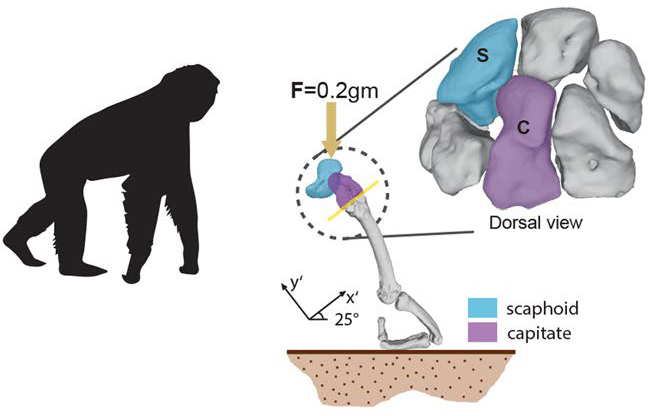

[PDF](/files/pdf/scaphoid.pdf){.btn .btn-sm .btn-outline-primary .me-1 .mb-1} [Online version](https://doi.org/10.1038/s41598-020-60590-6){.btn .btn-sm .btn-outline-primary .me-1 .mb-1}

```{=html}
<div class="pub-altmetric"><div data-badge-popover="right" data-badge-type="donut" data-doi="10.1038/s41598-020-60590-6" data-hide-no-mentions="true" class="altmetric-embed"></div></div>
```

{.pub-figure .lightbox}

## Abstract

Inferring the locomotor behaviour of the last common ancestor (LCA) of humans and African apes is still a divisive issue. An African great-ape-like ancestor using knuckle-walking is still the most parsimonious hypothesis for the LCA, despite diverse conflicting lines of evidence. Crucial to this hypothesis is the role of the centrale in the hominoid wrist, since the fusion of this bone with the scaphoid is among the clearest morphological synapomorphies of African apes and hominins. However, the exact functional significance of this fusion remains unclear. We address this question by carrying out finite element simulations of the hominoid wrist during knuckle-walking by virtually generating fused and unfused morphologies in a sample of hominoids. finite element analysis was applied to test the hypothesis that a fused scaphoid-centrale better withstands the loads derived from knuckle-walking. the results show that fused morphologies display lower stress values, hence supporting a biomechanical explanation for the fusion as a functional adaptation for knuckle-walking. this functional interpretation for the fusion contrasts with the current inferred positional behaviour of the earliest hominins, thus suggesting that this morphology was probably retained from an LcA that exhibited knuckle-walking as part of its locomotor repertoire and that was probably later exapted for other functions.

::: {.callout-note collapse="true" appearance="simple" icon=false}
## Cite (BibTeX)

```bibtex
@article{puschel_biomechanical_2020,
	title = {The biomechanical importance of the scaphoid-centrale fusion during simulated knuckle-walking and its implications for human locomotor evolution},
	volume = {10},
	copyright = {2020 The Author(s)},
	issn = {2045-2322},
	url = {https://www.nature.com/articles/s41598-020-60590-6},
	doi = {10.1038/s41598-020-60590-6},
	language = {en},
	number = {1},
	journal = {Scientific Reports},
	author = {Püschel, Thomas A. and Marcé-Nogué, Jordi and Chamberlain, Andrew T. and Yoxall, Alaster and Sellers, William I.},
	month = feb,
	year = {2020},
	pages = {1--7}
}
```
:::
