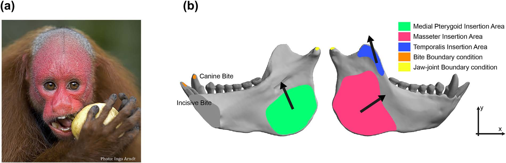

[PDF](/files/pdf/ajp22759.pdf){.btn .btn-sm .btn-outline-primary .me-1 .mb-1} [Online version](https://onlinelibrary.wiley.com/doi/abs/10.1002/ajp.22759){.btn .btn-sm .btn-outline-primary .me-1 .mb-1} [Online version](https://doi.org/10.1002/ajp.22759){.btn .btn-sm .btn-outline-primary .me-1 .mb-1}

```{=html}
<div class="pub-altmetric"><div data-badge-popover="right" data-badge-type="donut" data-doi="10.1002/ajp.22759" data-hide-no-mentions="true" class="altmetric-embed"></div></div>
```

{.pub-figure .lightbox}

## Abstract

Primates are interpreted to be ancestrally adapted to frugivory, although some modern groups show clear adaptations to other diets. Among them, pitheciids stand out for specifically predating seeds. This dietary specialization is known as sclerocarpy and refers to the extraction of seeds from surrounding hard tissues using the anterior dentition followed by the mastication of seeds by the molars. It has been proposed that *Callicebus-Pithecia-Chiropotes-Cacajao* represent a morphocline of increasingly specialized anatomical traits for sclerocarpic foraging. This study addresses whether there is a sclerocarpic specialization gradient in the mandibular morphology of pitheciids. Finite element analysis (FEA) was used to simulate two biting scenarios and the obtained stress values were compared between different pitheciids. Geometric morphometrics (GM) were used to display the morphological variation of this group. No support was found for the morphocline hypothesis from a biomechanical viewpoint since all pitheciins showed similar stress values and on average *Chiropotes* rather than *Cacajao* exhibited the strongest mandible. From a morphological perspective, it was found that there is indeed relative "robusticity" continuum in the pitheciid mandible for some aspects of shape as expected for the morphocline hypothesis, but this gradient could be related to other factors rather than sclerocarpic specialization. The present results are expected to contribute to a better insight regarding the ecomorphological relationship between mandibular morphology and mechanical performance among pitheciids.

::: {.callout-note collapse="true" appearance="simple" icon=false}
## Cite (BibTeX)

```bibtex
@article{puschel_analyzing_2018,
	title = {Analyzing the sclerocarpy adaptations of the {Pitheciidae} mandible},
	volume = {80},
	copyright = {© 2018 Wiley Periodicals, Inc.},
	issn = {1098-2345},
	url = {https://onlinelibrary.wiley.com/doi/abs/10.1002/ajp.22759},
	doi = {10.1002/ajp.22759},
	language = {en},
	number = {5},
	journal = {American Journal of Primatology},
	author = {Püschel, Thomas A. and Marcé‐Nogué, Jordi and Kaiser, Thomas M. and Brocklehurst, Robert J. and Sellers, William I.},
	year = {2018},
	keywords = {finite element analysis, geometric morphometrics, lower jaw, pitheciids, seed predation},
	pages = {e22759}
}
```
:::
