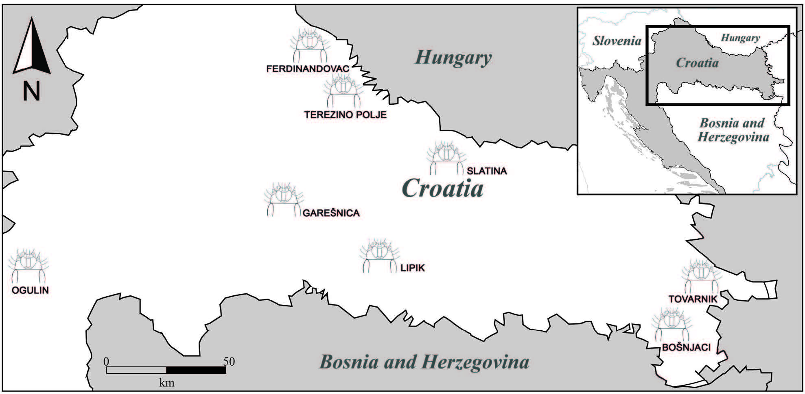

[PDF](/files/pdf/wire.pdf){.btn .btn-sm .btn-outline-primary .me-1 .mb-1} [Online version](https://doi.org/10.1371/journal.pone.0102059){.btn .btn-sm .btn-outline-primary .me-1 .mb-1}

```{=html}
<div class="pub-altmetric"><div data-badge-popover="right" data-badge-type="donut" data-doi="10.1371/journal.pone.0102059" data-hide-no-mentions="true" class="altmetric-embed"></div></div>
```

{.pub-figure .lightbox}

## Abstract

Studying the association between organismal morphology and environmental conditions has been very useful to test hypothesis regarding the influence of climate on shape. It has been long recognized that different environments produce dissimilar stress levels in insects, which can be reflected on the ability of an individual to overcome these pressures and spread further. *Agriotes* (Coleoptera Elateridae) species infest agricultural fields in different parts of Croatia, inhabiting different climatic conditions. Previous biological studies have indicated that there is a relationship between some *Agriotes* biological parameters such as density and climatic conditions such as soil moisture and temperature. However, it is still unknown how these environmental properties influence the wireworm morphological structure. This is highly relevant because the head of this species is directly involved in the mobility in the soil, thus affecting the invasive capacity of this insect. Therefore the aim of this study was to assess the association between different climatic conditions and the morphological variation of *Agriotes* cephalic capsule. Advanced multivariate analysis and geometric morphometric tool were applied to study the covariation between shape and environmental variables. Partial Least Squares methods were used in order to analyse the association between the wireworm head shape and three different climatic conditions soil type, temperature and rainfall. Our results showed that there is a high covariation between the wireworm head shape and the climatic conditions. It was suggested that the observed shape–environment association could be result of the high plasticity of this species in relation to its invasive capacity.

::: {.callout-note collapse="true" appearance="simple" icon=false}
## Cite (BibTeX)

```bibtex
@article{benitez_ecomorphological_2014,
	title = {Ecomorphological {Variation} of the {Wireworm} {Cephalic} {Capsule}: {Studying} the {Interaction} of {Environment} and {Geometric} {Shape}},
	volume = {9},
	shorttitle = {Ecomorphological {Variation} of the {Wireworm} {Cephalic} {Capsule}},
	url = {http://dx.doi.org/10.1371/journal.pone.0102059},
	doi = {10.1371/journal.pone.0102059},
	number = {7},
	journal = {PLoS ONE},
	author = {Benítez, Hugo A. and Püschel, Thomas and Lemic, Darija and Čačija, Maja and Kozina, Antonela and Bažok, Renata},
	month = jul,
	year = {2014},
	pages = {e102059}
}
```
:::
