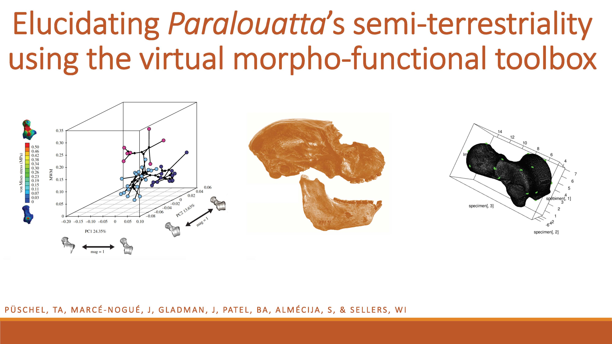

::: {.pub-venue}
AAPA 2020 · Los Angeles
:::

[PDF](/files/pdf/AAPA_2020.pdf){.btn .btn-sm .btn-outline-primary .me-1 .mb-1} [Video](https://youtu.be/xrUag96oTrs){.btn .btn-sm .btn-outline-primary .me-1 .mb-1} [Event](https://youtu.be/xrUag96oTrs){.btn .btn-sm .btn-outline-primary .me-1 .mb-1}

{.pub-figure .lightbox}

## Abstract

THOMAS A. PÜSCHEL, JORDI MARCÉ-NOGUÉ, JUSTIN GLADMAN, BIREN A. PATEL, SERGIO ALMÉCIJA and WILLIAM I. SELLERS

Find the paper [here](/publication/getting/)
