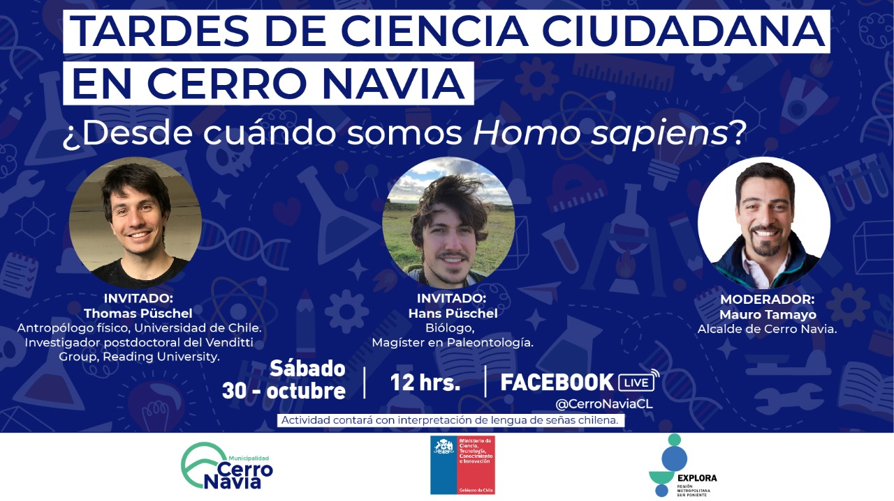

::: {.pub-venue}
Talk
:::

[Event](https://fb.watch/9EBeCVV7Zw/){.btn .btn-sm .btn-outline-primary .me-1 .mb-1}

{.pub-figure .lightbox}

## Abstract

On 30th November 2021, my brother and I will talk about palaeontology and palaeanthropology with the Cerro Navia community, Chile. You can follow Cerro Navia's Facebook page  and view the video stream of our talk [here](https://fb.watch/9EBeCVV7Zw/) [in Spanish].
