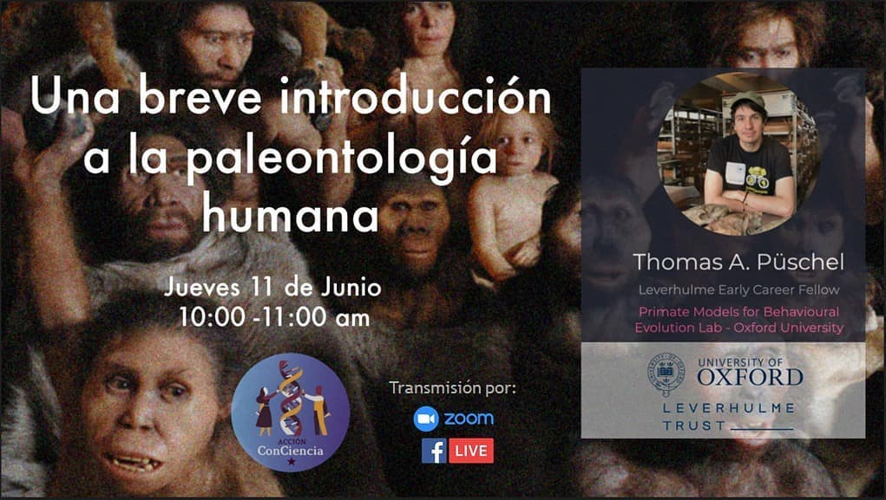

::: {.pub-venue}
Talk · Colegio Divina Pastora Yungay, Ñuble & Biobío region Chile
:::

[Event](https://www.facebook.com/accion.conciencia.biobio/photos/a.754668684988571/988219191633518/){.btn .btn-sm .btn-outline-primary .me-1 .mb-1}

{.pub-figure .lightbox}

## Abstract

On 11th June 2020, I will lead Acción Conciencia's first Ñuble and Biobio (Chile) talks with a conversation on human paleontology and the scientific career for high school students "Una breve introducción a la paleontologia humana". The Acción Conciencia are a group of professionals and students passionate about promoting science and research. Working for evidence-based policies, gender equality and the democratization of knowledge. You can follow their Facebook page  and view the video stream of my talk [here](https://www.facebook.com/accion.conciencia.biobio) [in Spanish].
