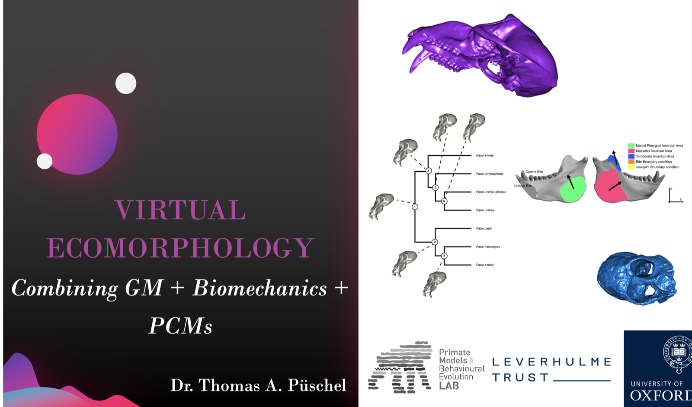

::: {.pub-venue}
I Congreso Iberoamericano de Morfometría Geométrica · U Catolica Maule
:::

[PDF](/files/pdf/virtual_ecomorphology.pdf){.btn .btn-sm .btn-outline-primary .me-1 .mb-1} [Video](https://youtu.be/o6cP9PUm5WM){.btn .btn-sm .btn-outline-primary .me-1 .mb-1} [Event](https://www.morphoshape.com/meetings){.btn .btn-sm .btn-outline-primary .me-1 .mb-1}

{.pub-figure .lightbox}

## Abstract

Talk on ecomorphology and how to combine geometric morphometrics, biomechanics and PCMs
