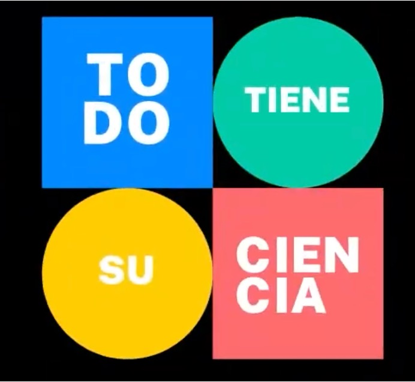

::: {.pub-venue}
Talk · Ciencia Publica channel
:::

[Event](https://youtu.be/sRryyPaGYLY){.btn .btn-sm .btn-outline-primary .me-1 .mb-1}

{.pub-figure .lightbox}

## Abstract

On 24th October 2021, I will talk about my scientific career and research as part of the 'Todo tiene su Ciencia' Online TV show. The video stream of my talk is available [here](https://youtu.be/sRryyPaGYLY) [in Spanish].
