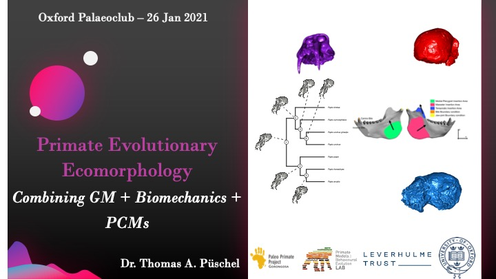

::: {.pub-venue}
Oxford
:::

[PDF](/files/pdf/paleoclub_26jan.pdf){.btn .btn-sm .btn-outline-primary .me-1 .mb-1} [Event](https://palaeobiology.web.ox.ac.uk/events){.btn .btn-sm .btn-outline-primary .me-1 .mb-1}

{.pub-figure .lightbox}

## Abstract

THOMAS A. PÜSCHEL
