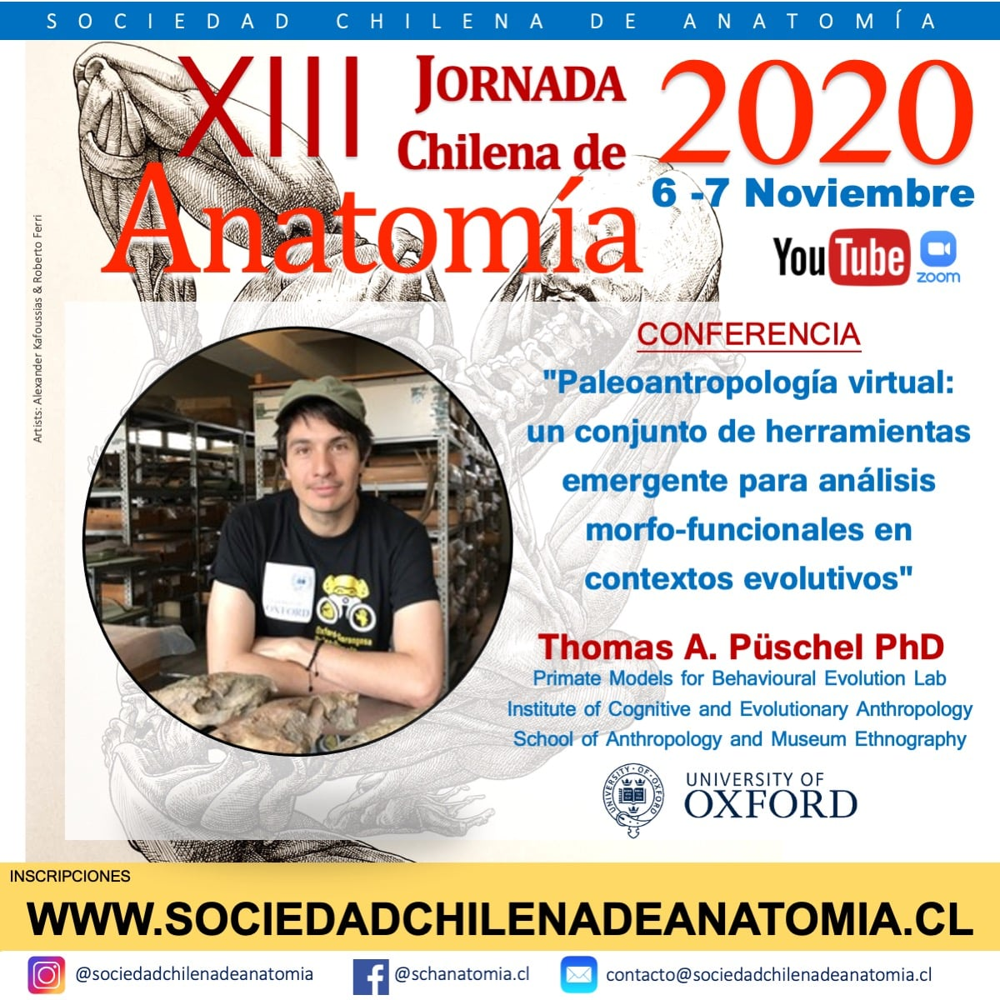

::: {.pub-venue}
Santiago de Chile
:::

[PDF](/files/pdf/XII_SOC_ANATOMIAv2.pdf){.btn .btn-sm .btn-outline-primary .me-1 .mb-1} [Video](https://youtu.be/F6gHTUM5Ahc){.btn .btn-sm .btn-outline-primary .me-1 .mb-1} [Event](http://www.sociedadchilenadeanatomia.cl/){.btn .btn-sm .btn-outline-primary .me-1 .mb-1}

{.pub-figure .lightbox}

## Abstract

THOMAS A. PÜSCHEL
