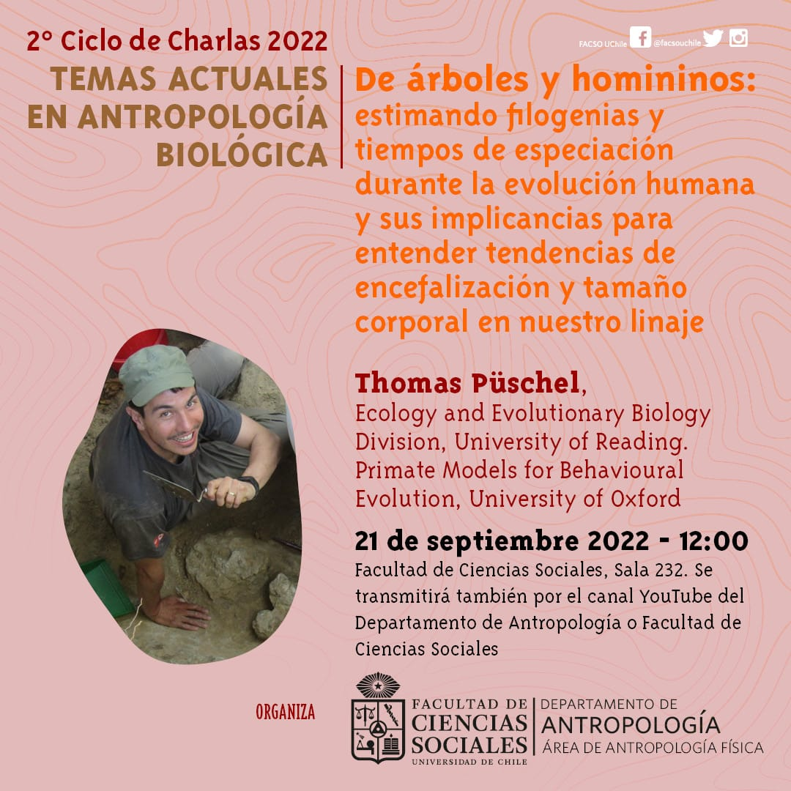

::: {.pub-venue}
Santiago de Chile
:::

[Video](https://youtu.be/-C5IPVKKpzw){.btn .btn-sm .btn-outline-primary .me-1 .mb-1} [Event](https://www.youtube.com/watch?v=-C5IPVKKpzw&list=PLEn0uSy9SLGD-o1Xnyc7iXMgPPbXZvHgv&index=14){.btn .btn-sm .btn-outline-primary .me-1 .mb-1}

{.pub-figure .lightbox}

## Abstract

THOMAS A. PÜSCHEL
